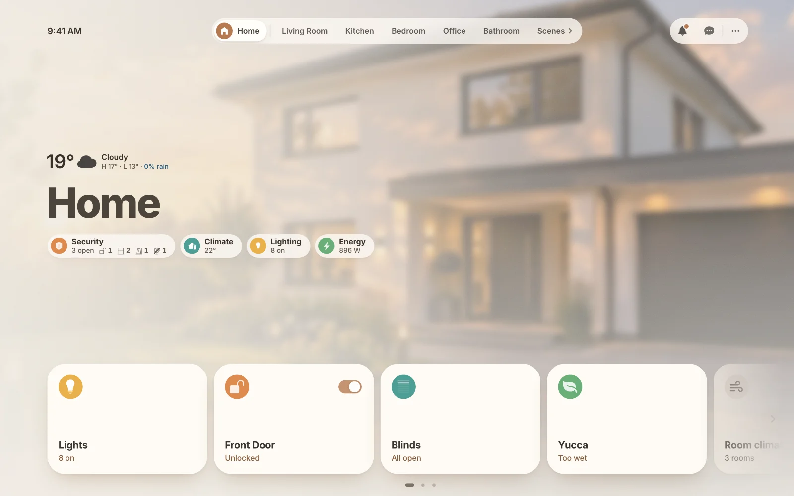
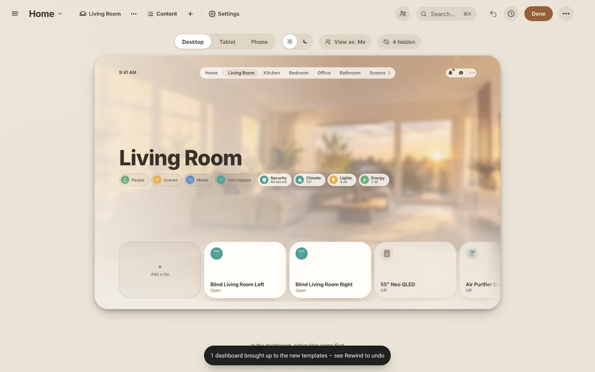

<picture>
  <source media="(prefers-color-scheme: dark)" srcset="docs/images/readme-title-dark.webp" />
  
</picture>

<a href="https://sh1ft-w.github.io/casora"><b>Website</b></a>&emsp;<a href="#get-started">Get started</a>&emsp;<a href="#using-it">Using it</a>&emsp;<a href="#studio">Studio</a>&emsp;<a href="CHANGELOG.md">Changelog</a>

 

A calm, photo-backed dashboard for Home Assistant that **sets itself up**. Casora reads your device registry, puts every device into its room and builds a layout each for desktop, wall tablet and phone. You shape the rest in **Casora Studio**, a visual editor in the sidebar. No YAML.

Casora builds on two cards from the Marketplace, **UI eXtension (UIX)** and **button-card**, and needs dashboards in storage mode, the default.

  <picture>
    <source media="(prefers-color-scheme: dark)" srcset="docs/images/casora-desktop-dark.webp" />
    
  </picture>

## What you get

Every popup puts the one thing you opened it for in the middle, usually a large dial, with scenes and modes as round buttons around it and lists beside it.

  <picture>
    <source media="(prefers-color-scheme: dark)" srcset="docs/images/readme-popups-dark.webp" />
    
  </picture>
   Heating and lighting on the phone, blinds on the desktop: one dial each.

| You have | The popup puts first |
|:--|:--|
| Lights and light groups | Brightness on a dial, Warm, Neutral, Cold and Color, every room with its switch |
| Thermostats and heating | Temperature on a dial, or − and + |
| Blinds and covers | Position on a dial, Open and Close around it |
| Fans, air purifiers, media players | A dial as well, the volume for media, and songs with a seek bar |
| Room climate | Temperature, humidity or air quality, and when to open or close a window |
| Washer, dryer, dishwasher, 3D printer, robot vacuum and mower, coffee machine, car, e-bike | How far, and when it is done |
| Alarm, doors and windows, locks, batteries, updates | A ring in pieces, green when all is well |
| Weather | Today's low to high on the ring, the next hours and 7 days |
| Plants | Soil moisture on the dial, and what the plant needs in plain words |
| Car fuel | When to refuel, and the cheapest station nearby on a map |
| Cameras, doorbells, Frigate, calendar, waste collection, football, lists | Their picture or table |

Anything else gets the **Universal tile** or an **own badge**, each with a popup you assemble, or any Home Assistant card as a custom tile. More devices come as Community cards (see [Good to know](#good-to-know)).

**New in 26.11:** popups rebuilt around one dial, a search for rooms, devices and scenes, export and import of whole dashboards, and Casora is in the Marketplace. Every change in the [changelog](CHANGELOG.md).

## Get started

You need **Home Assistant 2026.9** or newer, [UI eXtension](https://github.com/Lint-Free-Technology/uix) (the successor to card-mod; use it instead of card-mod, not both) and [button-card](https://github.com/custom-cards/button-card). An **AI task** in Home Assistant is optional, for the AI features.

1. **Install it.** Search for **Casora** under **Settings > Marketplace** (called HACS before Home Assistant 2026.11), download it together with **UI eXtension** and **button-card** if you don't have them yet, and restart Home Assistant.
2. **Add the integrations.** Under **Settings > Devices & services > Add integration** add **Casora**, and **UI eXtension** if it isn't added yet. UIX does nothing until it is added there.
3. **Open Casora Studio** in the sidebar. It checks the requirements and links you to anything missing.
4. **Pick a look and your rooms.** The setup assistant asks for the design, the font and which rooms get a page. Your Home Assistant areas are the starting point.
5. **Fill your rooms.** Automatically, with AI (which also places devices without a room and names tiles, after a cost estimate) or empty. A preview shows what goes where before anything is created.

Casora creates its helpers and registers its dashboard resources itself; nothing is written into your configuration. Updates arrive through the Marketplace. Step by step in the [guide](docs/guide.md#the-setup-assistant).

Install by hand

1. Download the [latest release](https://github.com/SH1FT-W/casora/releases) and copy its `custom_components/casora` folder into `/config/custom_components/`.
2. Install UIX and button-card if you don't have them yet, then restart Home Assistant.

To update, replace the folder with the new release and restart. New versions show up under **Settings > Updates**.

Coming from Hemma

Casora finds your Hemma dashboards, Hemma 1 (YAML) and Hemma 2 (Hemma Studio), and carries over rooms, tiles, the phone layout and your own cards.

1. **Make a backup** in Home Assistant, just to be safe.
2. **Install Casora** and open the Studio. It lists everything that will move.
3. **Choose** for each tile you changed: keep yours, take Casora's, or let AI merge the two.

Casora builds a new dashboard next to your old one and saves a copy of the original first. Your own JS modules, customised popups and folders your automations write to are kept as they are. More in the [guide](docs/guide.md#moving-from-hemma).

## Using it

| You do | Casora does |
|:--|:--|
| Tap the icon of a tile | Switches the device |
| Tap the rest of the tile | Opens its popup |
| Press and hold a tile (right-click on desktop) | A quick menu at the tile: the main action, brightness, position, temperature or volume, timers like "off in 30 minutes", history, the device and Edit tile |
| Pull down on Home (phone), Cmd+K or Ctrl+K (desktop) | Searches rooms, devices and scenes; switch or start them right in the list |
| Open the bell | What needs attention: open doors, low batteries, finished appliances, updates and Home Assistant's notifications |

Unlock, Open door and the alarm always ask before they act; any other tile can ask too. When you arm the alarm, Casora names open windows and doors.

## Studio

Rooms, tiles, badges and popups, changed in place with a live preview for desktop, tablet and phone. Tap anything in the preview to change it beside it, press and hold to try the real popup.

  <picture>
    <source media="(prefers-color-scheme: dark)" srcset="docs/images/casora-studio-dark.webp" />
    
  </picture>

- **Nothing is written until you click Save.** A draft survives a reload, and every save becomes a version: 30 per dashboard, each one can be previewed and restored.
- **New devices find their place.** The device assistant spots what is new and suggests room and tile.
- **Export and import.** Save a dashboard as a file, with photos and settings if you like. On import Casora shows a preview, maps missing devices and asks before it replaces anything.
- **Three designs,** each light and dark: **Casora** (warm linen), **Casora Nebel** (cool grey with a petrol accent) and **Casora Glas** (frosted glass over your room photos, opaque in performance mode for older tablets).

More pictures

 

  <picture>
    <source media="(prefers-color-scheme: dark)" srcset="docs/images/readme-screens-dark.webp" />
    
  </picture>
   Desktop, wall tablet and phone, each with its own layout.

<picture><source media="(prefers-color-scheme: dark)" srcset="docs/images/design-casora-dark.webp" /></picture>
<picture><source media="(prefers-color-scheme: dark)" srcset="docs/images/design-nebel-dark.webp" /></picture>
<picture><source media="(prefers-color-scheme: dark)" srcset="docs/images/design-glas-dark.webp" /></picture>
 Casora, Casora Nebel and Casora Glas.

## Your data

- **No cloud.** Casora runs inside your Home Assistant: no account, no analytics, no telemetry. Dashboards, versions and settings are part of its regular backups.
- **AI only if you ask.** With an AI task set up, Casora can place and name devices and adds helpers such as an energy, heating and ventilation coach, camera descriptions or a plant doctor. They run on your own provider, show a cost estimate first and all start switched off.
- **Online only for what you use:** AI, integration logos from `brands.home-assistant.io`, the check for new Casora releases on GitHub and, if you use them, fuel prices, the football table and the status of your card requests. The full list is in the [guide](docs/guide.md#privacy-in-detail).

## Good to know

- **Community cards** (Frigate camera, Reolink doorbell, Velair thermostat, chart, pet tracker, Bring! shopping list, kettle) ship with Casora but only appear in **Add a tile** once you add them under **Community** in the Studio. Nothing is downloaded from outside your Home Assistant.
- **Missing a card?** Request it in the Studio under **Community > Request a card**. Casora prepares a GitHub issue without entity names, rooms or places, shows you the text and you submit it yourself. The Studio then shows where it stands.
- **After an update** Casora brings your dashboards up to its new templates and saves a version first. Templates you changed yourself stay as they are. It never restarts Home Assistant on its own.
- **Versions** are `YY.M.N`: year, month and the number of the release in that month. The jump from 1.6.0 was intended.

Troubleshooting

- **Something old after an update.** Open the dashboard in Casora Studio and click **Save**; that brings in the current templates.
- **A tile says "Device missing".** The device behind it no longer exists in Home Assistant. See the [guide](docs/guide.md#when-a-device-is-missing).
- **Layout looks wrong on one device.** Open the dashboard there with `?casora_diag` added to the address (or tap the page title five times quickly) and copy the display diagnosis.

When you open an [issue](https://github.com/SH1FT-W/casora/issues), add the diagnostics from the Studio (**⋯ > Help > Copy diagnostics**): versions and counts only, no names. More answers in the [FAQ](docs/guide.md#faq-and-troubleshooting).

Documentation

- [Guide](docs/guide.md): setup assistant, Studio, looks, moving from Hemma, rewind, AI features, FAQ, actions
- [Advanced YAML](docs/ADVANCED.md): tuning Casora dashboards by hand (installing without the integration is not supported)
- [Contributing](docs/contributing.md): pull requests and screenshots
- [Changelog](CHANGELOG.md), also in [German](CHANGELOG.de.md)

Thanks

Casora gets better with every bug report and every idea. A big thank you to:

- [**@srsly88**](https://github.com/srsly88): from the very first issue on. Fuel prices, plants, waste and the phone layout, and lately a sharp eye on every corner of the new popups.
- [**@stalakerob**](https://github.com/stalakerob): the most reports of all. The chart card and its heatmap, the Universal tile, own badges with their own popups, the energy flow, entity lists, Frigate streams and the room search.
- [**@Westerloer**](https://github.com/Westerloer): navigation, energy, blinds, climate, network and the history, always with clear steps to reproduce.
- [**@vitidron**](https://github.com/vitidron): tireless testing of the Reolink doorbell, plus the Tractive, dishwasher and script button wishes.
- [**@andreasgoetzke**](https://github.com/andreasgoetzke): the feels-like temperature, the weather curves and the e-bike live battery.
- [**@gekberlin**](https://github.com/gekberlin): the thermostat and Velair extensions, the calendar card and the wish for clear robot vacuum errors.
- [**@chrischtili**](https://github.com/chrischtili): copying whole dashboards, scripts on a tile and the Bring! shopping list.
- [**@customstudioyandexru**](https://github.com/customstudioyandexru), [**@dnestico**](https://github.com/dnestico): the kettle card, Cyrillic room names and the wish that started the Frigate card.

## License

[MIT](LICENSE). Casora is built on [Hemma](https://github.com/willsanderson/Hemma) by [Will Sanderson](https://github.com/willsanderson), which grew out of [Homio](https://github.com/iamtherufus/Homio) by [@iamtherufus](https://github.com/iamtherufus); the original Hemma copyright notice is kept. Thank you both.

Casora is an independent project and is not affiliated with Home Assistant or Nabu Casa.

 

 
More open source for Home Assistant and the Mac at <a href="https://sh1ft-w.github.io">sh1ft-w.github.io</a>
 
Like this project? <a href="https://buymeacoffee.com/sh1ft_w">Buy me a coffee</a>

