

<picture>
  <source media="(prefers-color-scheme: dark)" srcset="docs/images/readme-title-dark.png" />
  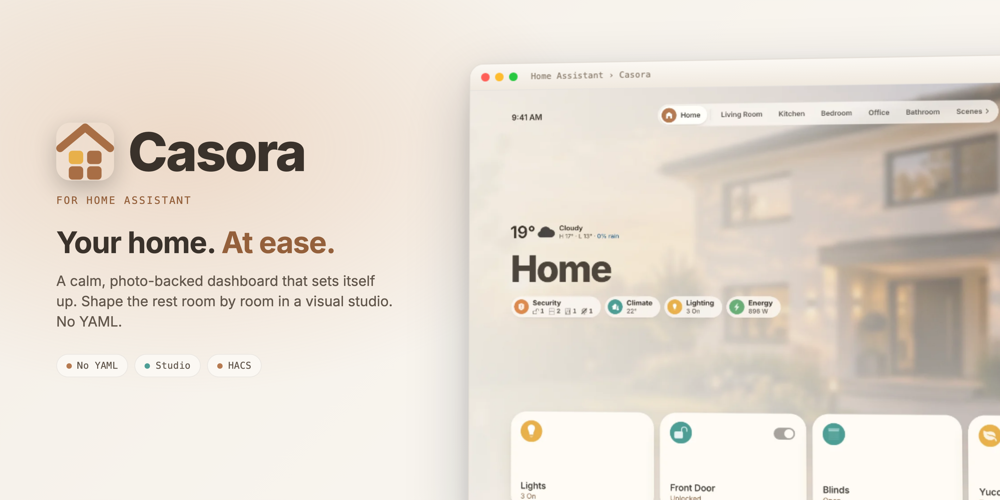
</picture>

A calm, photo-backed dashboard that sets itself up. 
Shape the rest room by room in a visual studio. No YAML.

<a href="https://sh1ft-w.github.io/casora"><b>Website</b></a> &nbsp;·&nbsp; <a href="#new">New</a> &nbsp;·&nbsp; <a href="#layouts">Layouts</a> &nbsp;·&nbsp; <a href="#popups">Popups</a> &nbsp;·&nbsp; <a href="#studio">Studio</a> &nbsp;·&nbsp; <a href="#look">Designs</a> &nbsp;·&nbsp; <a href="#privacy">Privacy</a> &nbsp;·&nbsp; <a href="#install">Install</a> &nbsp;·&nbsp; <a href="CHANGELOG.md">Changelog</a>

 

<b>JUST ARRIVED</b>
## Four new cards. One new look.

Community cards come with every Casora release and wait in the Studio until you add them, so your tile list stays short.

<picture>
  <source media="(prefers-color-scheme: dark)" srcset="docs/images/readme-cards-new-dark.png" />
  
</picture>

And a new look: **Casora Glas** 26.10.31, frosted glass over your room photos, light and dark, next to Casora and Casora Nebel. In performance mode the glass turns opaque.

Missing a card for one of your devices? Request it in the Studio under **Community**. It may become a card for everyone.

Every change, release by release, in the [changelog](CHANGELOG.md).

 

<b>SETUP</b>
## It already knows your home.

Casora reads Home Assistant's device registry, puts every device into its room and groups what belongs together. Your first dashboard is ready before you have touched a single tile.

The setup assistant in Casora Studio walks you through it: pick a look, let Casora sort your devices into rooms, check the preview and create your dashboard.

- **0** lines of YAML to get started. Everything is set up in the Studio.
- **31** room types with their own photos, for day and for night.
- **30** versions kept for every dashboard, ready to restore.

 

<b>DESKTOP, TABLET, PHONE</b>
## One home. Three screens.

Every screen gets a layout made for it. Not a shrunken copy.

  <picture>
    <source media="(prefers-color-scheme: dark)" srcset="docs/images/readme-screens-dark.webp" />
    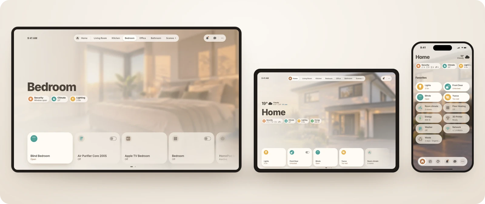
  </picture>

<picture>
  <source media="(prefers-color-scheme: dark)" srcset="docs/images/readme-cards-layouts-dark.png" />
  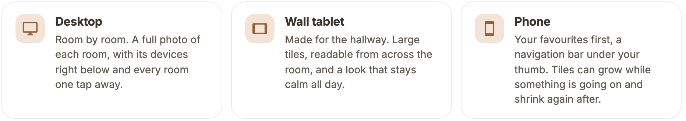
</picture>

 

<b>POPUPS</b>
## Tap a tile. See the whole story.

Lights, climate, energy, locks, blinds, media, cameras, plants, washers and dryers each open a popup of their own. Controls on the left, devices on the right, the rarely used tucked away under **More**.

  <picture>
    <source media="(prefers-color-scheme: dark)" srcset="docs/images/readme-popups-dark.webp" />
    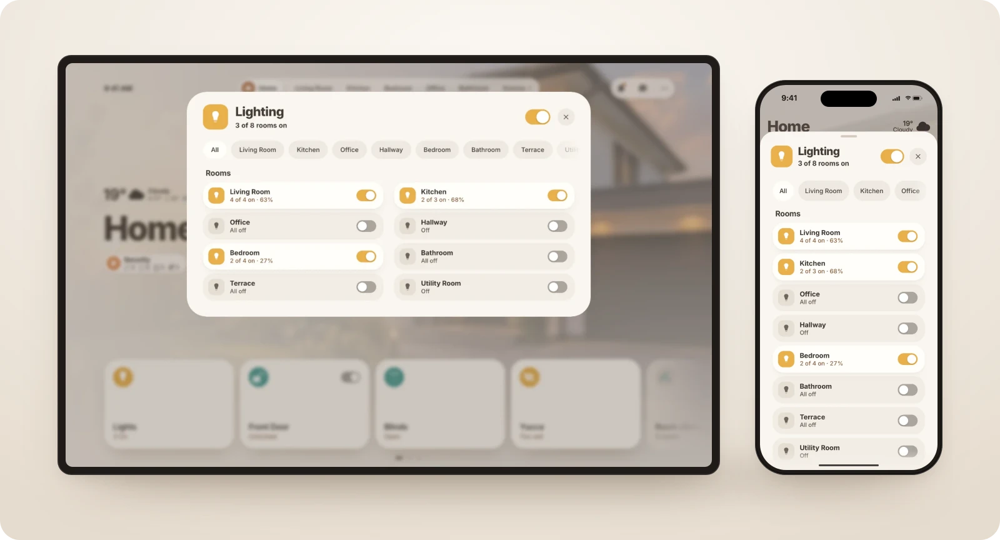
  </picture>
   <b>Every light in the home, grouped by room.</b> The rooms that are on highlighted, and a button to switch all off.

  <picture>
    <source media="(prefers-color-scheme: dark)" srcset="docs/images/readme-popups2-dark.webp" />
    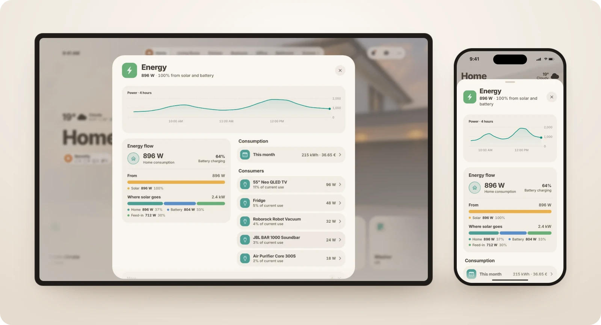
  </picture>
   <b>Energy at a glance.</b> Power right now, where it comes from, how the solar power splits between home, battery and grid, and which devices use the most.

<picture>
  <source media="(prefers-color-scheme: dark)" srcset="docs/images/readme-cards-popups-dark.png" />
  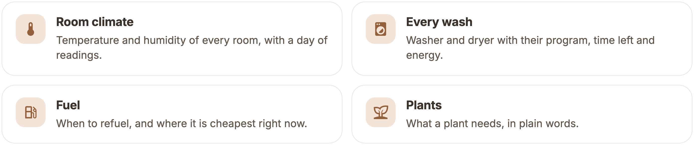
</picture>

 

<b>PRESS AND HOLD</b>
## Hold a tile. Everything is right there.

The everyday actions should not need a popup. Press and hold any tile and a small menu opens right at the tile, a bottom sheet on the phone, a right-click on the desktop.

<picture>
  <source media="(prefers-color-scheme: dark)" srcset="docs/images/readme-cards-hold-dark.png" />
  
</picture>

 

<b>TILES</b>
## Everything in your home. Already covered.

Casora picks the right tile and popup for each device on its own, with the integrations you already have.

<picture>
  <source media="(prefers-color-scheme: dark)" srcset="docs/images/readme-cards-tiles-dark.png" />
  
</picture>

### Community cards

Community cards ship with Casora, but they only appear in **Add tile** once you add them in the Community, so your tile list stays short. Every card has a preview of its tile and popup. Removing a card asks whether tiles that use it stay or go. Nothing is downloaded from outside your Home Assistant: a new Community card comes with a Casora release. If a card is ever retired, it disappears from **Add tile** first while existing tiles keep working, and only a later release removes it.

<b>Request a card and follow it</b>

 

**Request a card.** In the Studio, open **Community** in the header and choose **Request a card…**. Describe the device and what the tile and popup should show, and pick a few example entities. Casora prepares a GitHub issue for you and shows you the exact text before anything is sent. It contains the kind of device, units, device classes and attribute names, but no entity names, rooms or places. You submit it on GitHub yourself.

**Follow it.** Under **Your requests** in the Community the Studio shows where each request stands:

| State | Meaning |
|---|---|
| Open | Received, not picked up yet |
| Question | Something is unclear, the answer from the Casora team is shown right there |
| In progress | The card is being built |
| Built | The card ships with the next Casora release |
| Declined | Not planned, with the reason |

 

<b>CASORA STUDIO</b>
## Design it. Don't code it.

A visual editor in the Home Assistant sidebar. Rooms, tiles, badges and popups, changed in place with a live preview for desktop, tablet and phone. Tap anything in the preview and change it right beside it. Press and hold to try the real popup.

  <picture>
    <source media="(prefers-color-scheme: dark)" srcset="docs/images/readme-studio-dark.webp" />
    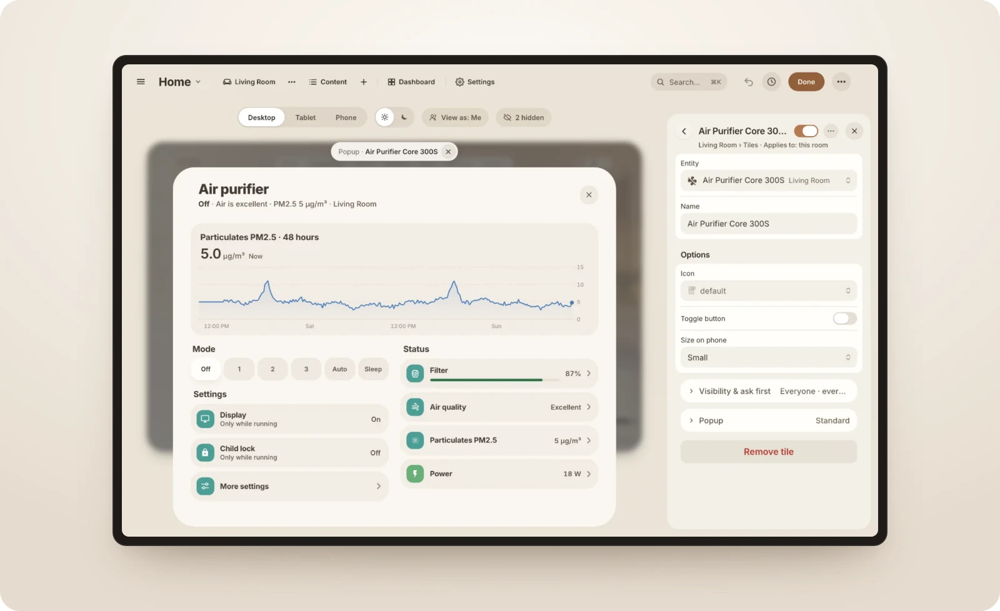
  </picture>
   <b>Casora Studio.</b> Rooms, tiles, badges and popups, edited in place. Nothing is written until you click Save.

  <picture>
    <source media="(prefers-color-scheme: dark)" srcset="docs/images/readme-tools-dark.webp" />
    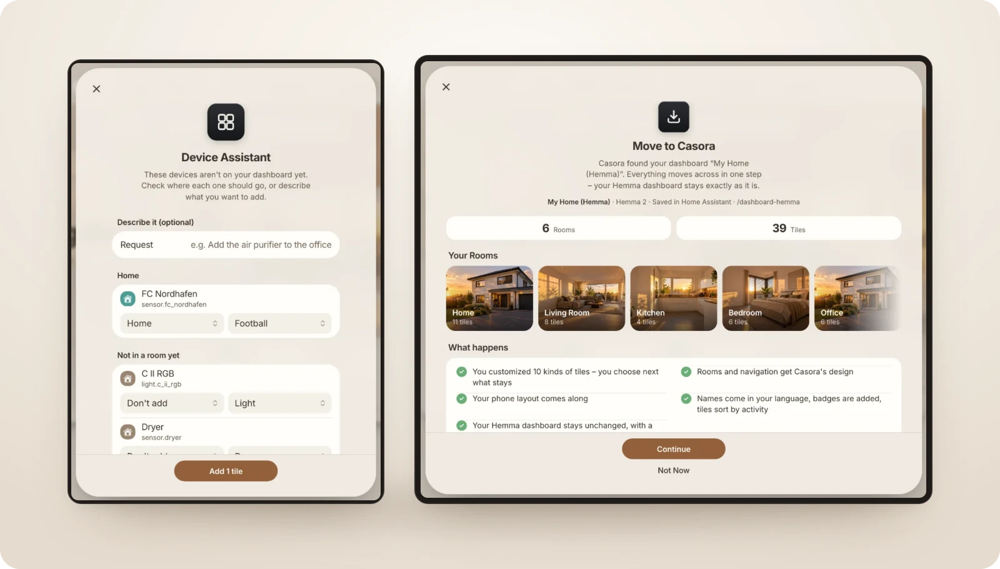
  </picture>
   <b>Assistants for the tedious part.</b> Place new devices, move from Hemma, go back to any version.

<picture>
  <source media="(prefers-color-scheme: dark)" srcset="docs/images/readme-cards-studio-dark.png" />
  
</picture>

 

<b>THREE DESIGNS</b>
## Soft by day. Warm by night.

Warm linen, generous corners and gentle shadows, set in Inter. All three designs come in light and dark and follow Home Assistant's theme mode.

<picture>
  <source media="(prefers-color-scheme: dark)" srcset="docs/images/readme-cards-looks-dark.png" />
  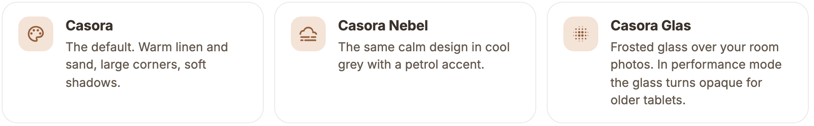
</picture>

<b>The three designs in pictures</b>

 

<picture><source media="(prefers-color-scheme: dark)" srcset="docs/images/design-casora-dark.webp" />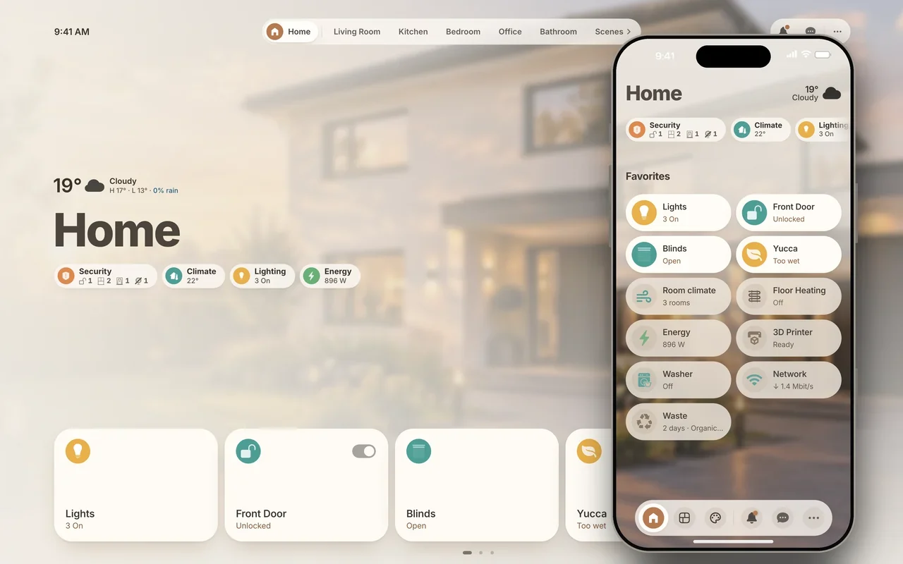</picture>
<picture><source media="(prefers-color-scheme: dark)" srcset="docs/images/design-nebel-dark.webp" />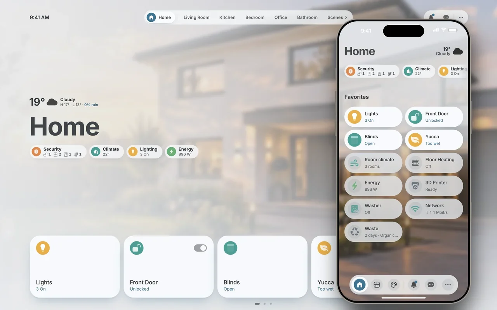</picture>
<picture><source media="(prefers-color-scheme: dark)" srcset="docs/images/design-glas-dark.webp" />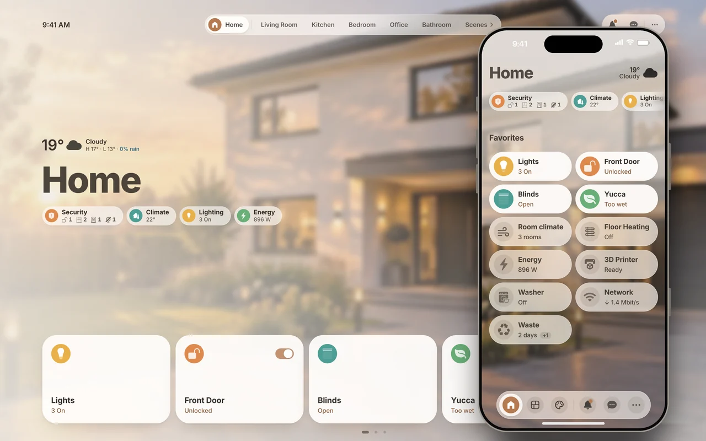</picture>
 Casora, Casora Nebel and Casora Glas.

 

<b>COMING FROM HEMMA</b>
## Moving feels like an update.

Casora finds your Hemma dashboards, both Hemma 1 (YAML) and Hemma 2 (Hemma Studio), and carries over rooms, tiles, the phone layout and your own cards. Your old dashboard stays untouched.

1. **Make a backup** in Home Assistant, just to be safe.
2. **Install Casora** and open the Studio. It lists everything that will move.
3. **Choose** for each tile you changed: keep yours, take Casora's, or let AI merge the two.

Your own JS modules, customised popups and folders your automations write to are kept as they are. Casora builds a new dashboard next to your old one and saves a copy of the original first. Your Hemma dashboard stays untouched until you choose to hide it. Step by step in the [guide](docs/guide.md#moving-from-hemma).

 

<b>INSTALL</b>
## Three steps. Then it's yours.

1. **Add the repository.** Click the button above, or in HACS open the menu, choose **Custom repositories** and add `https://github.com/SH1FT-W/casora` with the type **Integration**.
2. **Download Casora**, together with UIX and button-card if you don't have them yet, then **restart Home Assistant** once.
3. **Add the integrations** under Settings, Devices & services, Add integration: **Casora**, and **UI eXtension** if it isn't added yet. UIX does nothing until it is added there. Then open **Casora Studio** in the sidebar. The setup assistant takes it from there.

Updates arrive through HACS like any other integration. After an update, Casora brings your dashboards up to its new templates and saves a version first, so you can always go back. It never restarts Home Assistant on its own.

### What you need

| Requirement | Notes |
|---|---|
| **Home Assistant 2026.9** or newer | Required, with dashboards in storage mode (the default). |
| [**UI eXtension (UIX)**](https://github.com/Lint-Free-Technology/uix) | Required, from HACS. The successor to card-mod. After downloading, restart and add it under Settings, Devices & services, Add integration, **UI eXtension**. Use it instead of card-mod, not both. |
| [**button-card**](https://github.com/custom-cards/button-card) | Required, from HACS. |
| An **AI task** in Home Assistant | Optional, for the [AI features](docs/guide.md#ai-features-optional). |

Casora checks all of this when you first open the Studio and links you to anything missing. Helpers, scripts, resources and the theme are created by Casora itself.

<b>Without HACS</b>

 

1. Download the [latest release](https://github.com/SH1FT-W/casora/releases) and copy its `custom_components/casora` folder into `/config/custom_components/` on your Home Assistant.
2. Install UIX and button-card if you don't have them yet, then **restart Home Assistant**.
3. Add the **Casora** and **UI eXtension** integrations and open **Casora Studio** in the sidebar, as above.

To update, replace the folder with the new release and restart. Without HACS, new versions show up under Settings, Updates in Home Assistant. Step by step in the [guide](docs/guide.md#install).

### Versions

Since October 2026 Casora uses calendar versions **`YY.M.N`**: year, month, and the number of the release within that month. `26.10.31` is the 31st release of October 2026. Every release, feature or fix, gets the next number; there are no separate patch or minor versions. The jump from 1.6.0 was intended: HACS and the Casora update see the new version as usual.

### Documentation

- [**Guide**](docs/guide.md): setup assistant, Studio, looks, moving from Hemma, rewind, AI features, FAQ and troubleshooting, actions
- [**Advanced YAML**](docs/ADVANCED.md): building and tuning Casora dashboards by hand
- [**Contributing**](docs/contributing.md): pull requests and screenshots
- [**Changelog**](CHANGELOG.md): what changed in each version, in English and [German](CHANGELOG.de.md)

Found a bug or have an idea? [Open an issue](https://github.com/SH1FT-W/casora/issues).

 

<b>PRIVACY</b>
## It stays at home.

- **No cloud.** Casora runs entirely inside your Home Assistant. No account, no analytics, no telemetry.
- **Your data, your backups.** Dashboards, versions and settings live on your own instance and are part of its regular backups.
- **AI only if you ask.** AI features stay off until you turn them on, and then use the provider you already set up in Home Assistant.

Casora only reaches outside for AI features you turn on (through the provider you configured), for integration logos from `brands.home-assistant.io` and to look for new Casora releases on GitHub. Updates come through HACS or the release page. The full list is in the [guide](docs/guide.md#privacy-in-detail).

### Optional, and quietly useful

With an AI task set up in Home Assistant, Casora can place devices that have no room, name tiles, and adapt your own cards to its look. On the dashboard it adds a few helpers: an energy coach, a heating coach, a ventilation coach, camera descriptions, a plant doctor, an aquarium doctor, a bike check, an update check against your setup and a recipe of the week.

AI runs on your own provider account. Before each AI step in the Studio, Casora shows a cost estimate. Each feature has its own schedule (off, automatic or a time you pick), and on a new install all of them start switched off. Without an AI task, these features simply stay off. More in the [guide](docs/guide.md#ai-features-optional).

 

<b>CREDITS</b>
## Built on Hemma

Casora is built on [Hemma](https://github.com/willsanderson/Hemma) by [Will Sanderson](https://github.com/willsanderson), which grew out of [Homio](https://github.com/iamtherufus/Homio) by [@iamtherufus](https://github.com/iamtherufus). Thank you both.

Casora is an independent project and is not affiliated with Home Assistant or Nabu Casa. Released under the [MIT License](LICENSE). The original Hemma copyright notice is kept.

 

  A <a href="https://sh1ft-w.github.io"><b>SH1FT-W</b></a> project &nbsp;·&nbsp; <a href="https://sh1ft-w.github.io/flode">FLODE</a> &nbsp;·&nbsp; <a href="https://sh1ft-w.github.io/pulse">Pulse</a> &nbsp;·&nbsp; <a href="https://sh1ft-w.github.io/evenlight">Evenlight</a> &nbsp;·&nbsp; <a href="https://sh1ft-w.github.io/agentbar">AgentBar</a> &nbsp;·&nbsp; <a href="https://sh1ft-w.github.io/sharemount">ShareMount</a> &nbsp;·&nbsp; Built with <a href="https://claude.ai">Claude</a>

