

<picture>
  <source media="(prefers-color-scheme: dark)" srcset="docs/images/readme-title-dark.webp" />
  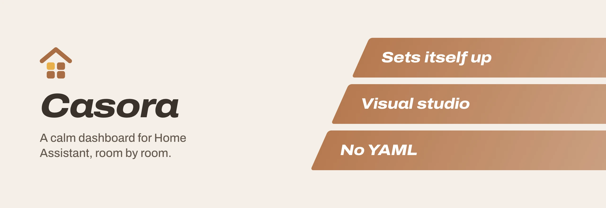
</picture>

A calm, photo-backed dashboard that sets itself up. 
Shape the rest room by room in a visual studio. No YAML.

<a href="https://sh1ft-w.github.io/casora"><b>Website</b></a> &nbsp;·&nbsp; <a href="#new">New</a> &nbsp;·&nbsp; <a href="#layouts">Layouts</a> &nbsp;·&nbsp; <a href="#popups">Popups</a> &nbsp;·&nbsp; <a href="#studio">Studio</a> &nbsp;·&nbsp; <a href="#look">Designs</a> &nbsp;·&nbsp; <a href="#privacy">Privacy</a> &nbsp;·&nbsp; <a href="#install">Install</a> &nbsp;·&nbsp; <a href="#thanks">Thanks</a> &nbsp;·&nbsp; <a href="CHANGELOG.md">Changelog</a>

 

<b>JUST ARRIVED</b>
## New popups. One calm dial.

Since 26.11 every popup follows one design: what you came for sits large in the middle, the rest in short lists beside it. Settings live in the Studio, not in the popup. Your feedback shaped every release since.

<!-- cards:new -->
<table>
<tr><td width="50%" valign="top"><picture><source media="(prefers-color-scheme: dark)" srcset="docs/images/icons/tune-dark.svg"></picture> <b>New popups with a dial</b> <code>26.11.1</code> Every popup is built the same way: a slim header that says what is going on, then one main thing, usually a large dial. Turn it for brightness, temperature, position or volume. Scenes, modes and programs sit around it as round buttons.</td><td width="50%" valign="top"><picture><source media="(prefers-color-scheme: dark)" srcset="docs/images/icons/thermometer-dark.svg"></picture> <b>Weather and climate</b> <code>26.11.1</code> A new weather popup: the dial runs from today's low to today's high, the middle shows the feels-like temperature, next to it the next hours and 7 days. The climate badges open a dial for temperature, humidity or air quality.</td></tr>
<tr><td width="50%" valign="top"><picture><source media="(prefers-color-scheme: dark)" srcset="docs/images/icons/palette-outline-dark.svg"></picture> <b>The ring shows the light</b> <code>26.11.4</code> Lamps that support colour get Color next to Warm, Neutral and Cold. The dial's ring takes the lamp's colour, and a room with lamps in different colours blends them. Lamps with effects get an Effects button.</td><td width="50%" valign="top"><picture><source media="(prefers-color-scheme: dark)" srcset="docs/images/icons/cellphone-dark.svg"></picture> <b>Search your home</b> <code>26.11.2</code> On the phone, pull down on Home to search rooms, devices and scenes, switch a device right in the list or start a scene. On the desktop, Cmd+K or Ctrl+K opens the same search.</td></tr>
<tr><td width="50%" valign="top"><picture><source media="(prefers-color-scheme: dark)" srcset="docs/images/icons/cctv-dark.svg">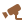</picture> <b>Bigger, clearer, quicker</b> <code>26.11.5</code> Tap the camera picture for a big live view, move through a song with the seek bar, flip switches right in the popup, and read the history with how long each state lasted.</td><td width="50%" valign="top"><picture><source media="(prefers-color-scheme: dark)" srcset="docs/images/icons/history-dark.svg"></picture> <b>Export and import</b> <code>26.11.2</code> Save a dashboard as a file, with photos and settings if you like, and pass it on. On import Casora shows a preview, maps missing devices and asks before it replaces anything.</td></tr>
</table>
<!-- /cards:new -->

Also new since 26.10.31: the **fridge** card, the **chart** card with lines, bars and a heatmap, the **Universal tile** and **own badges** that open a popup you assemble yourself, a **shopping list** for Bring! with **recipes** from Cookidoo, the **kettle**, the **alarm** with every mode as a button, and a calm **update prompt** when a new Casora is out.

Missing a card for one of your devices? Request it in the Studio under **Community**. It may become a card for everyone.

Every change, release by release, in the [changelog](CHANGELOG.md).

 

<b>SETUP</b>
## It already knows your home.

Casora reads Home Assistant's device registry, puts every device into its room and groups what belongs together. Your first dashboard is ready before you have touched a single tile.

The setup assistant in Casora Studio walks you through it: pick a look, let Casora sort your devices into rooms, check the preview and create your dashboard.

- **0** lines of YAML to get started. Everything is set up in the Studio.
- **31** room types with their own photos, for day and for night.
- **30** versions kept for every dashboard, ready to restore.

 

<b>DESKTOP, TABLET, PHONE</b>
## One home. Three screens.

Every screen gets a layout made for it. Not a shrunken copy.

  <picture>
    <source media="(prefers-color-scheme: dark)" srcset="docs/images/readme-screens-dark.webp" />
    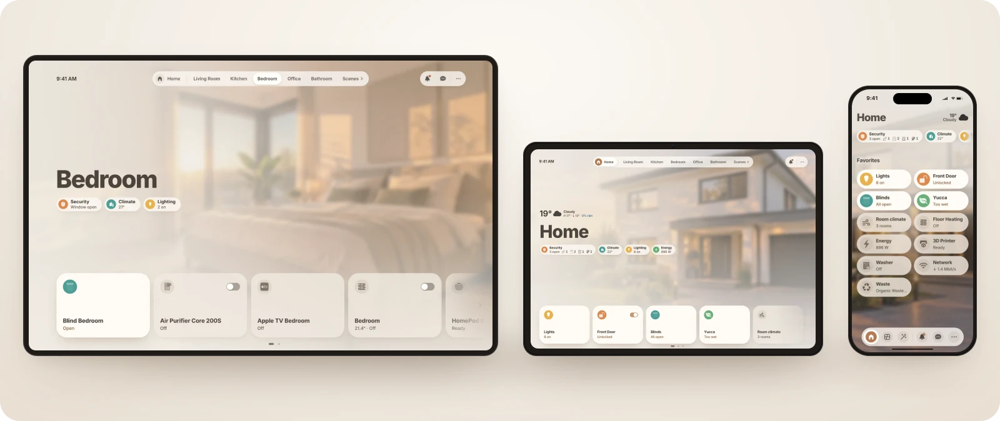
  </picture>

<!-- cards:layouts -->
<table>
<tr><td width="33%" valign="top"><picture><source media="(prefers-color-scheme: dark)" srcset="docs/images/icons/monitor-dark.svg"></picture> <b>Desktop</b> Room by room. A full photo of each room, with its devices right below and every room one tap away.</td><td width="33%" valign="top"><picture><source media="(prefers-color-scheme: dark)" srcset="docs/images/icons/tablet-dark.svg"></picture> <b>Wall tablet</b> Made for the hallway. Large tiles, readable from across the room, and a look that stays calm all day.</td><td width="33%" valign="top"><picture><source media="(prefers-color-scheme: dark)" srcset="docs/images/icons/cellphone-dark.svg"></picture> <b>Phone</b> Your favourites first, a navigation bar under your thumb. Tiles can grow while something is going on and shrink again after.</td></tr>
</table>
<!-- /cards:layouts -->

 

<b>POPUPS</b>
## Tap a tile. One thing first.

Every popup answers the question you opened it for at a glance. A slim header says what is going on, in words. Below it one main thing, usually a large dial, with scenes and modes as round buttons around it and a single history chart where it helps. Lists sit beside it on the desktop and below it on the phone. Settings stay in the Studio, so the popup stays calm.

  <picture>
    <source media="(prefers-color-scheme: dark)" srcset="docs/images/readme-popups-dark.webp" />
    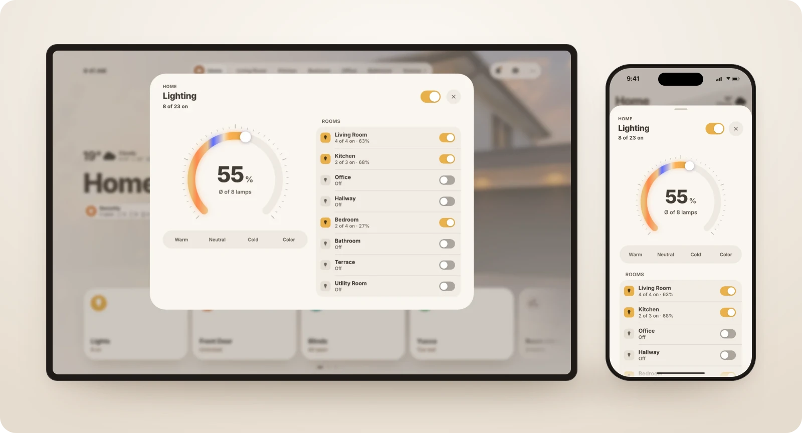
  </picture>
   <b>Every light in the home on one dial.</b> Turn the ring for brightness, pick a white tone or a colour, switch rooms on and off beside it.

  <picture>
    <source media="(prefers-color-scheme: dark)" srcset="docs/images/readme-popups2-dark.webp" />
    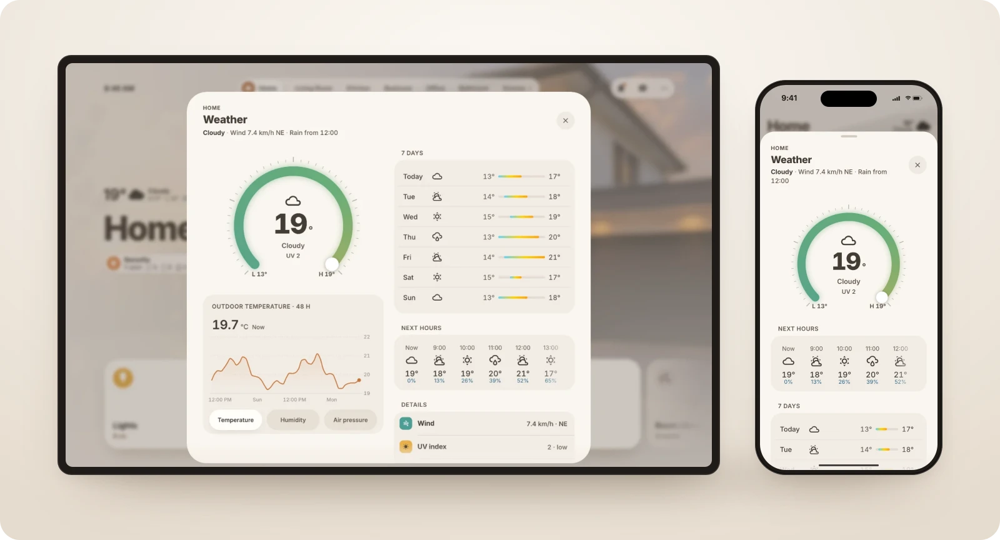
  </picture>
   <b>Weather on a dial.</b> Today's low and high as the ends of the ring, the next hours, 7 days and the last 48 hours of outdoor temperature.

<!-- cards:popups -->
<table>
<tr><td width="50%" valign="top"><picture><source media="(prefers-color-scheme: dark)" srcset="docs/images/icons/tune-dark.svg"></picture> <b>Turn</b> Lights, heating, thermostats, blinds, fans, purifiers and media volume. Drag the knob, or tap − and + for a temperature.</td><td width="50%" valign="top"><picture><source media="(prefers-color-scheme: dark)" srcset="docs/images/icons/timer-outline-dark.svg"></picture> <b>Progress</b> Washer, dryer, dishwasher, 3D printer, robot vacuum and mower, coffee machine, car and e-bike: how far, and when it is done.</td></tr>
<tr><td width="50%" valign="top"><picture><source media="(prefers-color-scheme: dark)" srcset="docs/images/icons/shield-home-outline-dark.svg"></picture> <b>Segments</b> Security, doors and windows, locks, batteries and updates. Every item is a piece of the ring, green when all is well.</td><td width="50%" valign="top"><picture><source media="(prefers-color-scheme: dark)" srcset="docs/images/icons/auto-fix-dark.svg"></picture> <b>Moons</b> Scenes, modes and programs as round buttons around the dial. With more than four, the last one opens the rest right there.</td></tr>
</table>
<!-- /cards:popups -->

Cameras, doorbells, Frigate, the calendar, waste collection, football and lists keep their picture or table.

 

<b>PRESS AND HOLD</b>
## Hold a tile. Everything is right there.

The everyday actions should not need a popup. Press and hold any tile and a small menu opens right at the tile, a bottom sheet on the phone, a right-click on the desktop.

<!-- cards:hold -->
<table>
<tr><td width="50%" valign="top"><picture><source media="(prefers-color-scheme: dark)" srcset="docs/images/icons/gesture-tap-hold-dark.svg"></picture> <b>The quick menu</b> The main action on top: turn off, unlock, pause. Below it brightness and colour, position, temperature, volume. Then history, the device, its page in Home Assistant and Edit tile.</td><td width="50%" valign="top"><picture><source media="(prefers-color-scheme: dark)" srcset="docs/images/icons/timer-outline-dark.svg"></picture> <b>Timers</b> Turn off in 30 minutes or on for 2 hours. The tile shows a ring that empties over time. Timers survive a restart and step aside when you switch by hand.</td></tr>
<tr><td width="50%" valign="top"><picture><source media="(prefers-color-scheme: dark)" srcset="docs/images/icons/arrow-left-dark.svg"></picture> <b>It stays in Casora</b> A reading opens its chart with 24 hours, 7 or 30 days. A light, door or window shows its history with how long each state lasted. Each with a back arrow, not Home Assistant's dialog.</td><td width="50%" valign="top"><picture><source media="(prefers-color-scheme: dark)" srcset="docs/images/icons/help-circle-outline-dark.svg"></picture> <b>Ask first, then switch</b> Any tile can ask before it switches. Unlock, Open door and the alarm always ask. When you arm the alarm, Casora names open windows and doors.</td></tr>
</table>
<!-- /cards:hold -->

 

<b>TILES</b>
## Everything in your home. Already covered.

Casora picks the right tile and popup for each device on its own, with the integrations you already have.

<!-- cards:tiles -->
<table>
<tr><td width="50%" valign="top"><picture><source media="(prefers-color-scheme: dark)" srcset="docs/images/icons/home-outline-dark.svg"></picture> <b>Every home</b> Lights and light groups, switches, scenes, blinds and covers, locks, thermostats and room climate, fans, air purifiers, humidifiers, media players, cameras and doorbells.</td><td width="50%" valign="top"><picture><source media="(prefers-color-scheme: dark)" srcset="docs/images/icons/shield-home-outline-dark.svg"></picture> <b>Safety</b> Alarm system, doors and windows, smoke, water and gas sensors, official warnings.</td></tr>
<tr><td width="50%" valign="top"><picture><source media="(prefers-color-scheme: dark)" srcset="docs/images/icons/lightning-bolt-outline-dark.svg"></picture> <b>Energy and house</b> Energy with solar and home battery, weather and warnings, batteries of all devices, network, updates, waste collection, calendar, Pulse.</td><td width="50%" valign="top"><picture><source media="(prefers-color-scheme: dark)" srcset="docs/images/icons/washing-machine-dark.svg"></picture> <b>Appliances</b> Washing machine, dryer, dishwasher, fridge and freezer, coffee machine, kettle, robot vacuum, robot lawn mower, 3D printer.</td></tr>
<tr><td width="50%" valign="top"><picture><source media="(prefers-color-scheme: dark)" srcset="docs/images/icons/car-outline-dark.svg"></picture> <b>On the road</b> Car with its own picture and fuel prices nearby, e-bike.</td><td width="50%" valign="top"><picture><source media="(prefers-color-scheme: dark)" srcset="docs/images/icons/flower-outline-dark.svg"></picture> <b>Hobbies</b> Plants, aquariums, football, game activity (PlayStation, Steam, Discord), recipes and meal plan, shopping list.</td></tr>
<tr><td width="50%" valign="top"><picture><source media="(prefers-color-scheme: dark)" srcset="docs/images/icons/account-group-outline-dark.svg"></picture> <b>Community cards</b> Frigate camera, Reolink doorbell, Velair thermostat, chart, pet tracker, Bring! shopping list, kettle. They wait in the Studio until you add them.</td><td width="50%" valign="top"><picture><source media="(prefers-color-scheme: dark)" srcset="docs/images/icons/puzzle-outline-dark.svg"></picture> <b>Your own</b> The Universal tile and own badges, each with a popup you assemble, entity lists, and any Home Assistant card as a custom tile.</td></tr>
</table>
<!-- /cards:tiles -->

### Community cards

Community cards ship with Casora, but they only appear in **Add a tile** once you add them in the Community, so your tile list stays short. Every card has a preview of its tile and popup. Removing a card asks whether tiles that use it stay or go. Nothing is downloaded from outside your Home Assistant: a new Community card comes with a Casora release. If a card is ever retired, it disappears from **Add a tile** first while existing tiles keep working, and only a later release removes it.

<b>Request a card and follow it</b>

 

**Request a card.** In the Studio, open **Community** in the toolbar (on a phone: **⋯** › **Community cards…**) and choose **Request a card…**. Describe the device and what the tile and popup should show, and pick a few example entities. Casora prepares a GitHub issue for you and shows you the exact text before anything is sent. It contains the kind of device, units, device classes and attribute names, but no entity names, rooms or places. You submit it on GitHub yourself.

**Follow it.** Under **Your requests** in the Community the Studio shows where each request stands:

| State | Meaning |
|---|---|
| Open | Received, not picked up yet |
| Question | Something is unclear, the answer from the Casora team is shown right there |
| In progress | The card is being built |
| Built | The card ships with the next Casora release |
| Declined | Not planned, with the reason |

 

<b>CASORA STUDIO</b>
## Design it. Don't code it.

A visual editor in the Home Assistant sidebar. Rooms, tiles, badges and popups, changed in place with a live preview for desktop, tablet and phone. Tap anything in the preview and change it right beside it. Press and hold to try the real popup.

  <picture>
    <source media="(prefers-color-scheme: dark)" srcset="docs/images/readme-studio-dark.webp" />
    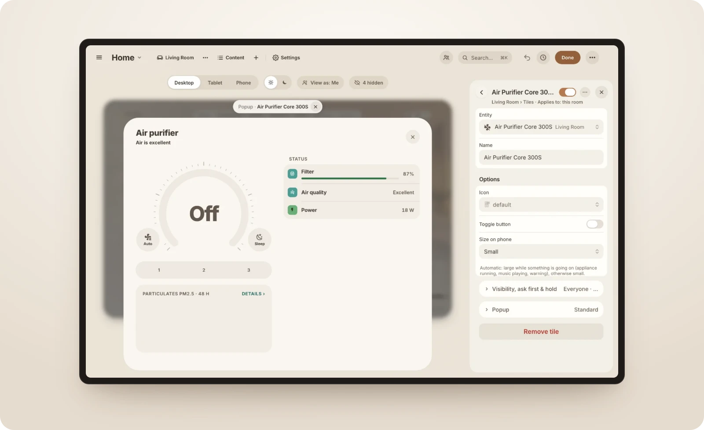
  </picture>
   <b>Casora Studio.</b> Rooms, tiles, badges and popups, edited in place. Nothing is written until you click Save.

  <picture>
    <source media="(prefers-color-scheme: dark)" srcset="docs/images/readme-tools-dark.webp" />
    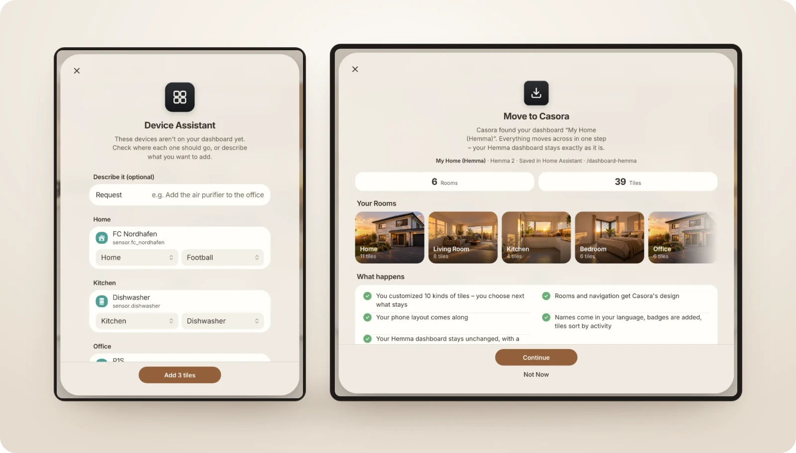
  </picture>
   <b>Assistants for the tedious part.</b> Place new devices, move from Hemma, go back to any version.

<!-- cards:studio -->
<table>
<tr><td width="50%" valign="top"><picture><source media="(prefers-color-scheme: dark)" srcset="docs/images/icons/eye-outline-dark.svg"></picture> <b>See it before you save</b> Switch the preview between desktop, tablet and phone. Nothing is written until you click Save, and a draft survives a reload.</td><td width="50%" valign="top"><picture><source media="(prefers-color-scheme: dark)" srcset="docs/images/icons/history-dark.svg"></picture> <b>Go back in time</b> Every save becomes a version. Preview any earlier one and restore it with a click. Nothing is ever lost.</td></tr>
<tr><td width="50%" valign="top"><picture><source media="(prefers-color-scheme: dark)" srcset="docs/images/icons/auto-fix-dark.svg"></picture> <b>New devices find their place</b> The device assistant spots what is new in your home and suggests the room and the tile. You decide.</td><td width="50%" valign="top"><picture><source media="(prefers-color-scheme: dark)" srcset="docs/images/icons/tune-dark.svg"></picture> <b>Hold is configurable</b> Under Settings, Controls, Hold on tiles picks what press and hold does: quick menu, popup or Home Assistant dialog, for all tiles or one.</td></tr>
<tr><td width="50%" valign="top"><picture><source media="(prefers-color-scheme: dark)" srcset="docs/images/icons/tune-dark.svg"></picture> <b>Settings by topic</b> One Settings page with a search and six topics: Look & feel, Messages, Home & Devices, Weather & climate, Controls, Extras. Hold on tiles, the order of security and climate, the phone search and the update prompt are all there.</td><td width="50%" valign="top"><picture><source media="(prefers-color-scheme: dark)" srcset="docs/images/icons/help-circle-outline-dark.svg"></picture> <b>How do I …?</b> Help in the Studio with short guides for the everyday tasks, such as a waste tile, a room photo, a new device or a new order, and a Show me that points to the right spot.</td></tr>
<tr><td width="50%" valign="top"><picture><source media="(prefers-color-scheme: dark)" srcset="docs/images/icons/history-dark.svg"></picture> <b>Export, import, copy</b> Save a dashboard as a file and import it elsewhere, with a preview and missing devices mapped. Copy a dashboard or duplicate a tile in one step.</td><td width="50%" valign="top"><picture><source media="(prefers-color-scheme: dark)" srcset="docs/images/icons/account-group-outline-dark.svg"></picture> <b>Request a card</b> Missing a device? Request a card in the Community and follow where it stands right in the Studio.</td></tr>
</table>
<!-- /cards:studio -->

 

<b>THREE DESIGNS</b>
## Soft by day. Warm by night.

Warm linen, generous corners and gentle shadows, set in Inter. All three designs come in light and dark and follow Home Assistant's theme mode.

<!-- cards:looks -->
<table>
<tr><td width="33%" valign="top"><picture><source media="(prefers-color-scheme: dark)" srcset="docs/images/icons/palette-outline-dark.svg"></picture> <b>Casora</b> The default. Warm linen and sand, large corners, soft shadows.</td><td width="33%" valign="top"><picture><source media="(prefers-color-scheme: dark)" srcset="docs/images/icons/weather-fog-dark.svg"></picture> <b>Casora Nebel</b> The same calm design in cool grey with a petrol accent.</td><td width="33%" valign="top"><picture><source media="(prefers-color-scheme: dark)" srcset="docs/images/icons/blur-dark.svg">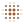</picture> <b>Casora Glas</b> Frosted glass over your room photos. In performance mode the glass turns opaque for older tablets.</td></tr>
</table>
<!-- /cards:looks -->

<b>The three designs in pictures</b>

 

<picture><source media="(prefers-color-scheme: dark)" srcset="docs/images/design-casora-dark.webp" />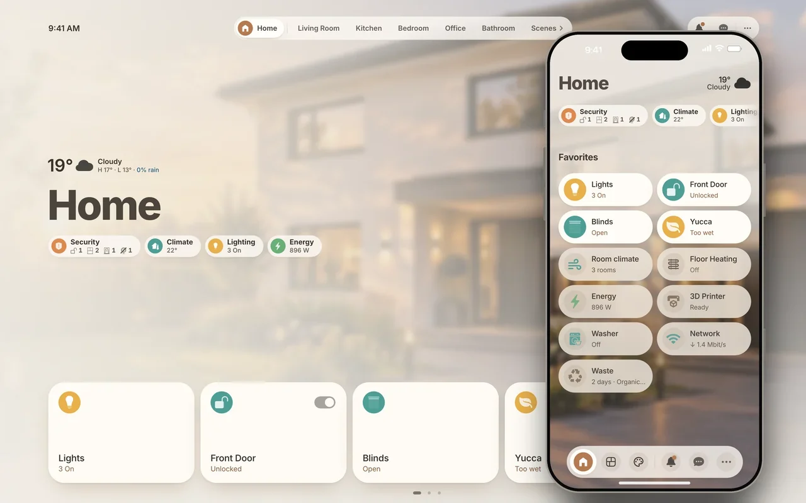</picture>
<picture><source media="(prefers-color-scheme: dark)" srcset="docs/images/design-nebel-dark.webp" />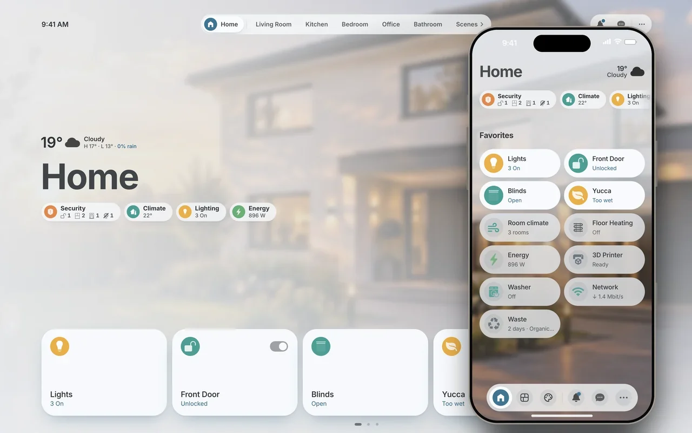</picture>
<picture><source media="(prefers-color-scheme: dark)" srcset="docs/images/design-glas-dark.webp" />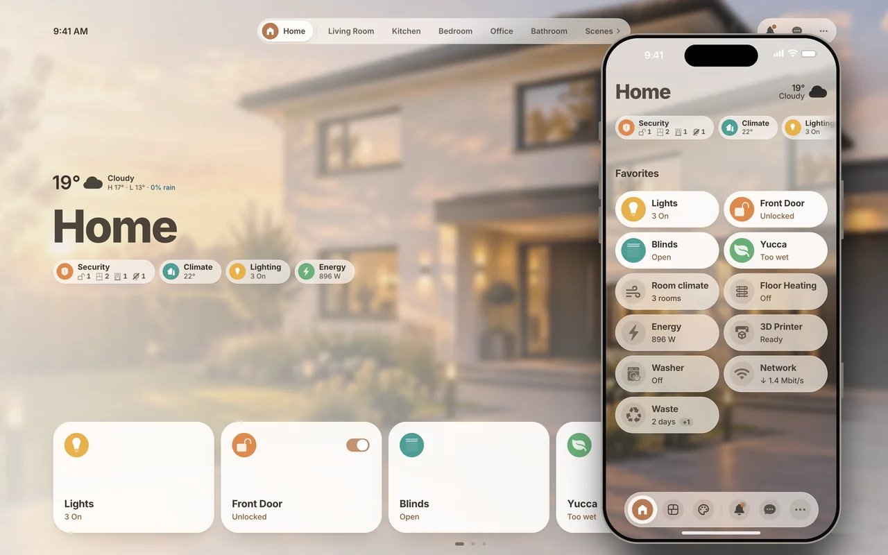</picture>
 Casora, Casora Nebel and Casora Glas.

 

<b>COMING FROM HEMMA</b>
## Moving feels like an update.

Casora finds your Hemma dashboards, both Hemma 1 (YAML) and Hemma 2 (Hemma Studio), and carries over rooms, tiles, the phone layout and your own cards. Your old dashboard stays untouched.

1. **Make a backup** in Home Assistant, just to be safe.
2. **Install Casora** and open the Studio. It lists everything that will move.
3. **Choose** for each tile you changed: keep yours, take Casora's, or let AI merge the two.

Your own JS modules, customised popups and folders your automations write to are kept as they are. Casora builds a new dashboard next to your old one and saves a copy of the original first. Your Hemma dashboard stays untouched until you choose to hide it. Step by step in the [guide](docs/guide.md#moving-from-hemma).

 

<b>INSTALL</b>
## Three steps. Then it's yours.

1. **Add the repository.** Click the button above, or in HACS open the menu, choose **Custom repositories** and add `https://github.com/SH1FT-W/casora` with the type **Integration**.
2. **Download Casora**, together with UIX and button-card if you don't have them yet, then **restart Home Assistant** once.
3. **Add the integrations** under Settings, Devices & services, Add integration: **Casora**, and **UI eXtension** if it isn't added yet. UIX does nothing until it is added there. Then open **Casora Studio** in the sidebar. The setup assistant takes it from there.

Updates arrive through HACS like any other integration. After an update, Casora brings your dashboards up to its new templates and saves a version first, so you can always go back. It never restarts Home Assistant on its own.

### What you need

| Requirement | Notes |
|---|---|
| **Home Assistant 2026.9** or newer | Required, with dashboards in storage mode (the default). |
| [**UI eXtension (UIX)**](https://github.com/Lint-Free-Technology/uix) | Required, from HACS. The successor to card-mod. After downloading, restart and add it under Settings, Devices & services, Add integration, **UI eXtension**. Use it instead of card-mod, not both. |
| [**button-card**](https://github.com/custom-cards/button-card) | Required, from HACS. |
| An **AI task** in Home Assistant | Optional, for the [AI features](docs/guide.md#ai-features-optional). |

Casora checks all of this when you first open the Studio and links you to anything missing. Casora creates its helpers and registers its dashboard resources itself; its actions and designs come with the integration, so nothing is written into your configuration.

<b>Without HACS</b>

 

1. Download the [latest release](https://github.com/SH1FT-W/casora/releases) and copy its `custom_components/casora` folder into `/config/custom_components/` on your Home Assistant.
2. Install UIX and button-card if you don't have them yet, then **restart Home Assistant**.
3. Add the **Casora** and **UI eXtension** integrations and open **Casora Studio** in the sidebar, as above.

To update, replace the folder with the new release and restart. Without HACS, new versions show up under Settings, Updates in Home Assistant. Step by step in the [guide](docs/guide.md#install).

### Versions

Since October 2026 Casora uses calendar versions **`YY.M.N`**: year, month, and the number of the release within that month. `26.10.31` is the 31st release of October 2026. Every release, feature or fix, gets the next number; there are no separate patch or minor versions. The jump from 1.6.0 was intended: HACS and the Casora update see the new version as usual.

### Documentation

- [**Guide**](docs/guide.md): setup assistant, Studio, looks, moving from Hemma, rewind, AI features, FAQ and troubleshooting, actions
- [**Advanced YAML**](docs/ADVANCED.md): building and tuning Casora dashboards by hand
- [**Contributing**](docs/contributing.md): pull requests and screenshots
- [**Changelog**](CHANGELOG.md): what changed in each version, in English and [German](CHANGELOG.de.md)

Found a bug or have an idea? [Open an issue](https://github.com/SH1FT-W/casora/issues). For a bug, add the diagnostics from the Studio (⋯ → **Help…** → **Copy diagnostics…**): versions and counts only, no names.

 

<b>PRIVACY</b>
## It stays at home.

- **No cloud.** Casora runs entirely inside your Home Assistant. No account, no analytics, no telemetry.
- **Your data, your backups.** Dashboards, versions and settings live on your own instance and are part of its regular backups.
- **AI only if you ask.** AI features stay off until you turn them on, and then use the provider you already set up in Home Assistant.

Casora only reaches outside for AI features you turn on (through the provider you configured, and for the AI update check the release notes of pending updates), for integration logos from `brands.home-assistant.io`, to look for new Casora releases on GitHub and, if you use them, for fuel prices, the football table and the status of your card requests. Updates come through HACS or the release page. The full list is in the [guide](docs/guide.md#privacy-in-detail).

### Optional, and quietly useful

With an AI task set up in Home Assistant, Casora can place devices that have no room, name tiles, and adapt your own cards to its look. On the dashboard it adds a few helpers: an energy coach, a heating coach, a ventilation coach, camera descriptions, a plant doctor, an aquarium doctor, a bike check, an update check against your setup and a recipe of the week.

AI runs on your own provider account. Before each AI step in the Studio, Casora shows a cost estimate. Each feature has its own schedule (off, automatic or a time you pick), and on a new install all of them start switched off. Without an AI task, these features simply stay off. More in the [guide](docs/guide.md#ai-features-optional).

 

<b>HALL OF FAME</b>
## Made better by you.

Casora gets better with every bug report and every idea. A big thank you to everyone who tests, reports and keeps asking for more:

- [**@stalakerob**](https://github.com/stalakerob): the most reports of all. The chart card and its heatmap, the Universal tile, own badges with their own popups, the energy flow, entity lists, Frigate streams and the room search.
- [**@srsly88**](https://github.com/srsly88): from the very first issue on. Fuel prices, plants, waste and the phone layout, and lately a sharp eye on every corner of the new popups.
- [**@Westerloer**](https://github.com/Westerloer): navigation, energy, blinds, climate, network and the history, always with clear steps to reproduce.
- [**@vitidron**](https://github.com/vitidron): tireless testing of the Reolink doorbell, plus the Tractive, dishwasher and script button wishes.
- [**@andreasgoetzke**](https://github.com/andreasgoetzke): the feels-like temperature, the weather curves and the e-bike live battery.
- [**@gekberlin**](https://github.com/gekberlin): the thermostat and Velair extensions, the calendar card and the wish for clear robot vacuum errors.
- [**@chrischtili**](https://github.com/chrischtili): copying whole dashboards, scripts on a tile and the Bring! shopping list.
- [**@customstudioyandexru**](https://github.com/customstudioyandexru), [**@dnestico**](https://github.com/dnestico): the kettle card, Cyrillic room names and the wish that started the Frigate card.

Found something or missing a card? [Open an issue](https://github.com/SH1FT-W/casora/issues/new/choose). You might be next on this list.

 

<b>CREDITS</b>
## Built on Hemma

Casora is built on [Hemma](https://github.com/willsanderson/Hemma) by [Will Sanderson](https://github.com/willsanderson), which grew out of [Homio](https://github.com/iamtherufus/Homio) by [@iamtherufus](https://github.com/iamtherufus). Thank you both.

Casora is an independent project and is not affiliated with Home Assistant or Nabu Casa. Released under the [MIT License](LICENSE). The original Hemma copyright notice is kept.

 

  A <a href="https://sh1ft-w.github.io"><b>SH1FT-W</b></a> project &nbsp;·&nbsp; <a href="https://sh1ft-w.github.io/flode">FLODE</a> &nbsp;·&nbsp; <a href="https://sh1ft-w.github.io/pulse">Pulse</a> &nbsp;·&nbsp; <a href="https://sh1ft-w.github.io/evenlight">Evenlight</a> &nbsp;·&nbsp; <a href="https://sh1ft-w.github.io/agentbar">AgentBar</a> &nbsp;·&nbsp; <a href="https://sh1ft-w.github.io/sharemount">ShareMount</a> &nbsp;·&nbsp; Built with <a href="https://claude.ai">Claude</a>

