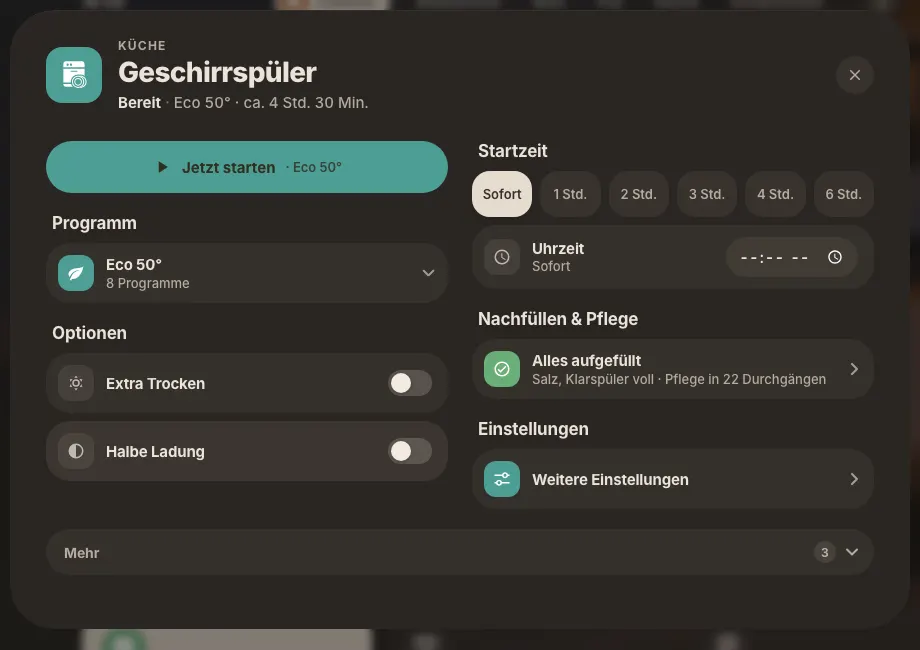
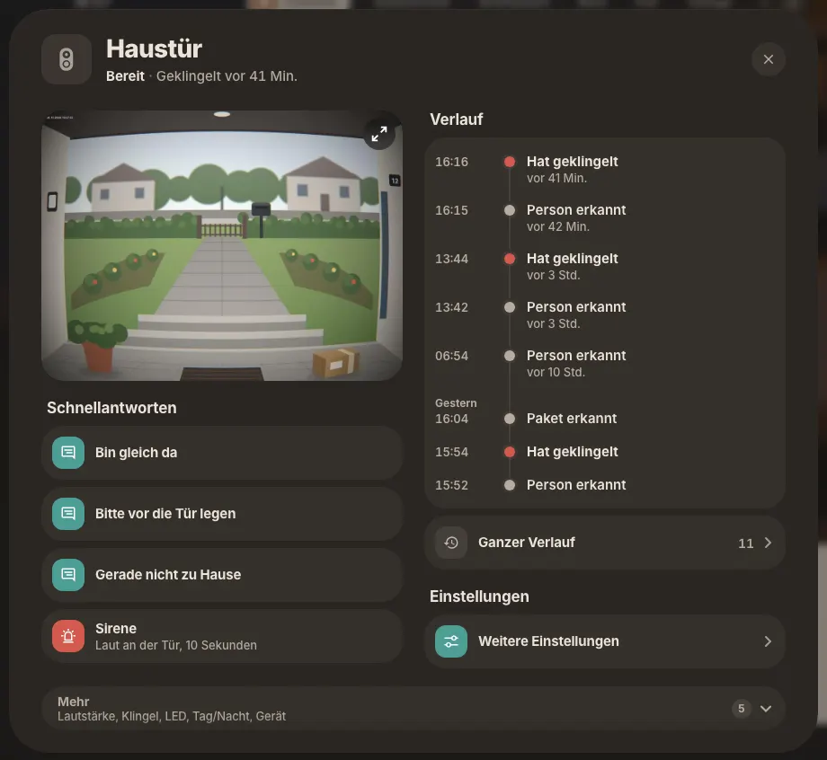
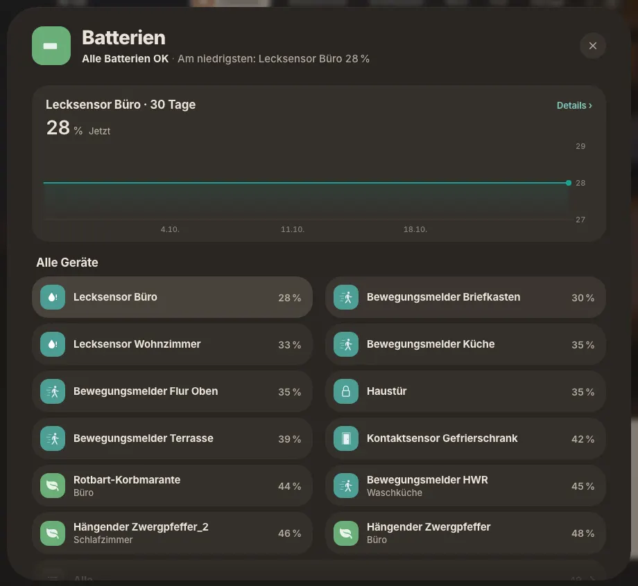

# Popup-Blaupause v2: ein Muster für alle Popups

Gilt seit 26.10.2026 (Entscheidung Maintainer: „Popup-Vorschläge komplett umsetzen“). Grundlage: Bestandsaufnahme aller
62 Popup-Arten und der Vorschlag „Casora-Popups einheitlich“ mit den Regeln v2. Ergänzt
[blaupause-popup.md](blaupause-popup.md) (Dateien, Live-Karten, Pflicht-Zustände) um das **Was steht wo**: jedes Popup
ist von oben nach unten gleich aufgebaut, aus denselben Bausteinen in `window._casoraUI` (`casora-core.js`).
Abgesichert durch `dev/unit/popup_blaupause.mjs` (siehe unten).

Umsetzung in drei Stufen: **1** Bausteine, diese Seite, Regeltest und die 47 kleinen Popups (b7) · **2** die 13 mittleren
(Thermostat, Velair, Luftreiniger/Lüfter, Alarm, Medien, Messwertseite, Schalter, Gerät allgemein, Abfall, Rezepte …) ·
**3** Schloss zusammenlegen und Kamera/Klingel/Frigate auf einen Aufbau. Was noch nicht umgestellt ist, steht mit Grund in
`dev/unit/popup_blaupause_ausnahmen.json`.



## 1. Aufbau von oben nach unten

```
Kopf        ‹ (Unterseite) · Symbol-Kachel · RAUM · Titel · Statuszeile │ Hauptschalter · X      (Rahmen)
Hauptbereich höchstens einer: Diagramm, Bild, Karte, Regler oder Player                           (Modul)
Aktionen    1–3 Pillen, die wichtigste gefüllt in Gerätefarbe                                   UI.actions
Abschnitte  Bedienung → Zustand → Verlauf → Einstellungen (Überschrift außen über der Platte)     UI.section
            Zeilen: Schalter · Wert · Weiter › · Weg ↗ · Aktion/Auswahl                          UI.row.*
            letzte Zeile in Geräte-Popups: „Weitere Einstellungen ›“                             UI.settings
Mehr        ein Block „Mehr (n) ⌄“ über volle Breite, Unterzeile nennt den Inhalt                UI.more
Leer        eine Leer-Zeile genau dort, wo Inhalt fehlt                                          UI.empty
Breite      552 einspaltig · 900 zwei Spalten oder Bild                                         UI.width
```

Desktop ab 761 px: links Bedienung, rechts der Rest; die Spalten dürfen ausgleichen und beginnen auf derselben Höhe (Regel 12). Handy: eine Spalte genau in der
Reihenfolge oben.

## 2. Die Regeln v2

1. **Kopf.** Symbol-Kachel · Etikett (Raum; auf Unterseiten die Seite davor; bei Sammel-Popups leer) · Titel =
   Gerätename ohne Raum, höchstens 2 Zeilen · Statuszeile: Zustand und höchstens 2 Zusätze, eine Zeitform (unter 1 Std.
   „vor 11 Min.“, sonst „seit 14:42“) · Hauptschalter · X. Der Zustand steht nicht noch einmal im Inhalt.
2. **Hauptschalter** schaltet, was die Kachel schaltet (Licht, Schalter, Lüfter, Fernseher, Frigate-Erkennung). Nie bei
   Schloss, Alarm, Tor, Sirene: dort eine Hauptaktion mit Rückfrage. Ist „Aus“ ein Modus (Heizung), bleibt es Modus.
   Mit Schalter gibt es kein zweites Aus/An; ein Modus antippen schaltet ein.
3. **Hauptbereich** höchstens einer, oben: Bild, Diagramm, Karte, Regler oder Player. Ein Wert hat ein Feld; zwei
   Bedienwege im selben Feld sind erlaubt.
4. **Aktionen**: eine Reihe mit 1 bis 3 Pillen direkt unter Kopf oder Hauptbereich (Handy bei 4: zwei Reihen). Die
   wichtigste gefüllt in der Farbe der Kopf-Kachel (aus: Familienfarbe), dunkle Schrift, die Beschriftung sagt, was
   passiert („Jetzt starten · Eco 50°“). Gefährliches nie gefüllt, immer mit Rückfrage.
5. **Abschnitte** in fester Folge Bedienung, Zustand, Verlauf, Einstellungen; Überschriften bleiben sprechend
   („Programm“). Ist der Verlauf der Hauptinhalt (Kamera, Klingel), kommt er gleich nach dem Hauptbereich.
6. **Zeilen**: Schalter-Zeile (echter Schalter; gesperrt: grau mit Grund) · Wert-Zeile · Weiter-Zeile › (Unterseite mit
   ‹) · Weg-Zeile ↗ (verlässt Casora) · Aktions- und Auswahl-Zeile ohne Pfeil (gewählt: hinterlegt, Symbol in Farbe). In
   Sammel-Popups: Schalter schaltet, Zeile öffnet. **› heißt immer: öffnet eine Seite mit ‹.**
7. **Unterseiten** im selben Popup, ‹ links, Etikett = Seite davor, kurzer Titel (nie die Gerätekennung), kein fremder
   Hauptschalter, höchstens 2 Ebenen. Bearbeiten ist eine Unterseite mit „Speichern“.
8. **Weitere Einstellungen**: letzte Zeile in jedem Geräte-Popup, im Halten-Menü dasselbe Wort. Bei mehreren Geräten
   zuerst die Auswahl. „In Home Assistant öffnen ↗“ nur auf der Geräteseite.
9. **Lange Listen und Mehr**: ab 12 Zeilen die ersten 12 und „Alle (n) ›“. Seltenes in genau einem „Mehr (n) ⌄“ ganz
   unten; die Unterzeile nennt den Inhalt. Keine Textlinks, keine einzelnen Fuß-Pillen.
10. **Leer, aus, offline**: eine Leer-Zeile genau dort, wo Inhalt fehlt – Symbol, Satz, höchstens eine Aktion
    („Erneut versuchen“, „Einschalten“, „Im Studio wählen ›“). Nicht erreichbar: Statuszeile sagt es, Bedienung grau,
    letzte Werte mit „zuletzt …“.
11. **Breite und Zugang**: Breite je Popup-Art fest – 900 bei zwei Spalten oder Bild, sonst 552. Trefferflächen mindestens
    44 px, Text auf Farbe mindestens 4,5 : 1, Symbol-Knöpfe mit Namen für die Sprachausgabe, Auswahl nie nur über Farbe.
    Hell, dunkel, Blatt- und Glas-Popups: dieselben Teile, nur Farben und Platten wechseln.
12. **Symmetrie zweier Spalten** (Desktop): beide Spalten beginnen auf derselben Höhe. Hat nur eine Spalte oben eine
    Überschrift, hält die andere deren Höhe frei, damit die ersten Platten auf einer Linie stehen. Jedes
    Zwei-Spalten-Layout meldet sein Spaltenpaar mit `UI.colsMark(a, b)` an; `casora-core` gleicht nach dem Öffnen und
    bei Größenänderung aus (`UI.alignCols`). Am Handy (eine Spalte) passiert nichts.

## 3. Entscheidungen des Maintainers (26.10.2026, verbindlich)

| # | Entscheidung | Folge im Muster |
|---|---|---|
| 1 | Schloss-Popup und Schloss-Ansicht werden **ein** Popup; „Verriegeln“ ist ein Knopf, kein Schalter im Kopf | Regel 2 (nie Schalter bei Schloss); Umbau in Stufe 3. Mehrere Schlösser: „Alle verriegeln“ gefüllt, „Alle entriegeln“ ungefüllt mit Rückfrage (seit Stufe 1) |
| 2 | Doppeltes Ein/Aus streichen (Befeuchter „Betrieb“, Freie Kachel „Bedienung“, „Aus“ in der Lüfter-Leiste, Medien „Einschalten“). Schalter-Popup: **nur** der Kopf-Schalter, der große Schalter in der Mitte fällt weg | Regel 2; ein Modus antippen schaltet ein |
| 3 | Diagramm-Umschalten (Batterien, Pflanze, Luftreiniger): **Variante A** – Zeile tippen wechselt das Diagramm im selben Popup, gewählte Zeile hinterlegt, kein › | Auswahl-Zeile (`UI.row.select` bzw. `noChev`); die Seite des gewählten Messwerts über „Details ›“ im Diagrammkopf |
| 4 | Thermostat: Plus/Minus und Leiste bleiben zusammen in **einem** Feld | Regel 3 („zwei Bedienwege im selben Feld“); Stufe 2 |
| 5 | Breite: einspaltig 552, Kamera-Popups bleiben 900, 900 sonst nur bei zwei Spalten | Regel 11; `UI.width('one' | 'two' | 'image')` |
| 6 | Ein Knopf-Stil: Hauptaktion oben in Gerätefarbe mit dunkler Schrift; Gefährliches (Sirene, Entriegeln) nie gefüllt | Regel 4; `UI.actions`, `.hh-pill.pri`, KI-Karte |
| + | Medien: Cover/Artwork bleibt der Hauptbereich, wo es eins gibt (wie heute) | Regel 3 |

## 4. Ausnahmen (bewusst, mit Grund)

Die fünf „sicher vermisst“-Fälle des Vorschlags sind Ausnahmen der Regeln v2:

- **Thermostat**: Plus/Minus und Leiste im selben Feld (Entscheidung 4).
- **Kamera-Größe**: Bild-Popups bleiben 900 breit, auch einspaltig (Regel 11).
- **Frigate**: Hauptschalter „Erkennung“ im Kopf (Regel 2: er schaltet, was die Kachel schaltet) und am Handy die letzten
  Erkennungen oben (Regel 5: Verlauf als Hauptinhalt).
- **Licht im Haus**: Raumzeilen mit Schalter öffnen zusätzlich den Raum (Regel 6, Sammel-Popups).

Eigene **Hauptbereiche** behalten: Farbrad, Kaffee-Getränke, Fußball-Tabelle, Abfall-Kalender, Rezepte, Frigate-Videos –
sie übernehmen alles außer Regel 3. **Glocke** und **Halten-Menü** bleiben Menüs, nehmen aber dieselben Wörter
(„Weitere Einstellungen“, „Löschen“ als Aktions-Zeile).

Offene Punkte aus Stufe 1 (nächster Wert der Nachbarn, bis entschieden): das Wetter behält die 7-Tage-Platte
(„dichte Zeilen“). Die Messwertseite hat seit Stufe 2 denselben Zeitraum-Umschalter wie das Diagramm-Popup.

Bleibende Altlasten nach Stufe 2 (in der Ausnahmeliste mit „bleibt“): das Blättern im Abfall-Monatsraster (›) und
der eigene Kopf des Licht-Popups im Standard-Design (ohne Casora-Theme gibt es keinen Rahmen-Kopf). Medien-Fernseher
schalten über den Hauptschalter im Kopf (Entscheidung 2), die Alarmanlage zeigt ihren Zustand in der Statuszeile.

## 5. Bausteine (`window._casoraUI`, `casora-core.js`)

| Baustein | Aufruf | Was er tut |
|---|---|---|
| Kopf | Rahmen (`casoraPopup.open`), `cfg.ring = { icon, hue }` für Seiten ohne Kachel | Symbol-Kachel, Raum-Etikett, Titel, Statuszeile (erste `UI.line`), Hauptschalter, X |
| Unterseite | `casoraPopup.sub(cfg)` | ‹ zurück zur Seite davor, Etikett = deren Titel, kein fremder Hauptschalter (`head_switch: false`) |
| Modul-Unterseite | `UI.page(name, fn)` + Zeile `{ page: 'name|arg' }` | Weiter-Zeile ›, die eine eigene Seite des Moduls öffnet (z. B. `dish-care`, `klingel-hist`, `bat-all`, `devices`) |
| Aktionen | `UI.actions([{ text, sub, icon, svc, primary, danger, confirm, disabled, attrs }])` | 1–3 Pillen, 52 hoch; `primary` in `--casora-popup-accent` mit dunkler Schrift; `danger` nie gefüllt, fragt immer (`svc.confirm`) |
| Abschnitt | `UI.section('control' \| 'state' \| 'history' \| 'settings', rows \| html, label?)` | Überschrift außen (Standardwort Bedienung/Zustand/Verlauf/Einstellungen oder sprechend), `data-casora-sec` |
| Schalter-Zeile | `UI.row.toggle({ icon, label, on, entity \| svc, confirm, disabled, reason })` | echter Schalter rechts (`UI.switchHtml`), aktiv hinterlegt; gesperrt grau mit Grund |
| Wert-Zeile | `UI.row.value({ icon, label, value })` | Wert rechts, nichts zum Tippen |
| Weiter-Zeile | `UI.row.next({ …, entity })` bzw. `{ page }` | Wert + ›, öffnet eine Seite mit ‹ (Messwert-/Geräteseite über `casoraRoute`) |
| Weg-Zeile | `UI.row.out({ …, url })` bzw. Zeile `out: true` | ↗ statt ›, verlässt Casora |
| Aktions-/Auswahl-Zeile | `UI.row.action({ …, svc })`, `UI.row.select({ …, selected })` | ohne Pfeil; gewählt = hinterlegt |
| Weitere Einstellungen | `UI.settingsRow(ids, { sub })`, `UI.settings(ids, rows?)`; Layout-Option `settings` in `HH.layout` (02-devices) und `K.layout` (05-weich-mehr) | letzte Zeile bzw. letzter Abschnitt; mehrere Geräte → erst die Auswahl (`devices`), dann die Geräteseite |
| Mehr | `UI.more(id, html, { count, hint })` | „Mehr (n) ⌄“; `hint` = Unterzeile mit dem Inhalt („Lautstärke, Klingel, LED …“) |
| Leer-Zeile | `UI.empty({ icon, text, sub, action \| entity \| studio \| out })` | eine Zeile mit Symbol, Satz und höchstens einer Aktion (Studio nur für Admins) |
| Spaltenpaar | `UI.colsMark(a, b)` im Wrapper eines Zwei-Spalten-Layouts | `casora-core` richtet die beiden Spalten nach dem Öffnen auf eine Höhe aus (Regel 12) |
| Breite | `UI.width('one' \| 'two' \| 'image')`, in Vorlagen `window.casoraPopupWidth(…)` | 552 bzw. 900; `style` gewinnt über die 900/920 aus `popup_styles` |
| KI-Karte | `UI.kiCard({ title, body, foot, btnText, btnSvc, primary })` | gemeinsamer Baustein für Lüftungs-Coach, Pflanzen-Doktor, Rad-Check, KI-Blick |
| Namen | `window.casoraCleanName(name, keepKind)` | ohne Gerätekennung („shellyswitch25-C45BB…“) für Zeilen und Seitentitel |

Beispiel (Geräte-Popup im Soft-Layout):

```js
return HH.layout({ entity: c.st, watch: watch, fields: f2, top: ['hero', 'pbar'],
  left: ['go', 'run', 'prog'], right: ['alerts', 'care', 'more'],
  settings: states[c.st] ? c.st : null });            // → „Einstellungen“ · „Weitere Einstellungen ›“ als letzter Abschnitt

// Hauptaktion oben (Feld 'go'):
UI.actions([{ text: 'Jetzt starten', sub: 'Eco 50°', icon: 'mdi:play', primary: true, svc: startSvc }]);
// Gefährlich: nie gefüllt, fragt immer
UI.actions([{ text: 'Alle verriegeln', primary: true, svc: lockAll },
            { text: 'Alle entriegeln', danger: true, confirm: 'Alle Schlösser entriegeln?', svc: unlockAll }]);
```



## 6. Regeltest

`dev/unit/popup_blaupause.mjs` (läuft mit allen `dev/unit/*.mjs` im Gate) prüft statisch:

1. die Bausteine sind da (`UI.section/row/settingsRow/settings/actions/empty/width/page`, `casoraPopup.sub`, 552/900,
   feste Abschnittsfolge, Markierungen `data-casora-sec`/`data-casora-bp`);
2. Breiten nur 552/900/920 (sonst `casoraPopupWidth`);
3. „Weitere Einstellungen“ nicht als eigene Zeile, sondern über `UI.settingsRow`/`UI.settings`;
4. jedes migrierte Geräte-Popup hat den Abschnitt „Weitere Einstellungen“ (Liste `geraete.migriert`, offen mit Grund);
5. kein eigener Kopf im Inhalt (28 px/800);
6. kein eigener ›-Pfeil (SVG, `mdi:chevron-right`);
7. keine Hauptaktion in fester Farbe (`--casora-soft-primary` ohne Gerätefarbe davor);
8. Symmetrie (Regel 12): `colsMark`/`alignCols` in `casora-core`, nach `casoraPopup.open` ausgeführt, und die
   Zwei-Spalten-Layouts in `02-devices.js`, `05-weich-mehr.js`, `05-standard-medien.js` melden ihr Paar an.

Altlasten stehen in `dev/unit/popup_blaupause_ausnahmen.json` mit Anzahl und Grund (Sperrklinke): mehr ist rot, weniger
auch – dann die Zahl senken. `node dev/unit/popup_blaupause.mjs --stand` zeigt den Stand.



## 7. Checkliste für ein neues oder umgebautes Popup

- [ ] Kopf vom Rahmen; Raum steht als Etikett, nicht im Titel oder in der Statuszeile
- [ ] Hauptschalter nur, wenn die Kachel schaltet; kein zweites Aus/An im Inhalt
- [ ] Hauptaktion mit `UI.actions` oben, Gefährliches mit `danger`
- [ ] Abschnitte über `UI.section` bzw. `UI.group(rows, 'Überschrift')` in der festen Folge
- [ ] Zeilen nach Art: echter Schalter, › nur für Unterseiten, ↗ für „verlässt Casora“, Auswahl ohne Pfeil
- [ ] Geräte-Popup: `settings` im Layout (oder `UI.settings`) – „Weitere Einstellungen“ als letzter Abschnitt
- [ ] Seltenes in einem `UI.more` mit `count` und `hint`; Leeres als `UI.empty`
- [ ] Breite über `casoraPopupWidth`: 552 einspaltig, 900 zweispaltig oder Bild
- [ ] Zwei Spalten: Paar mit `UI.colsMark` angemeldet, erste Platten stehen auf einer Linie
- [ ] `node dev/unit/popup_blaupause.mjs` grün, Ausnahmeliste nicht länger geworden
