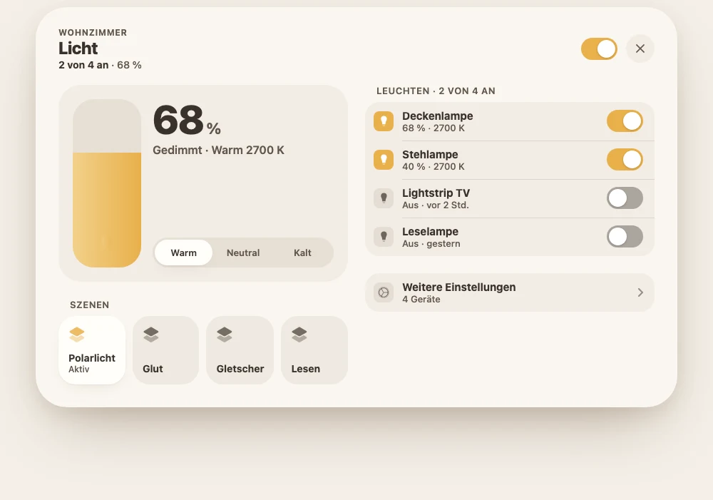
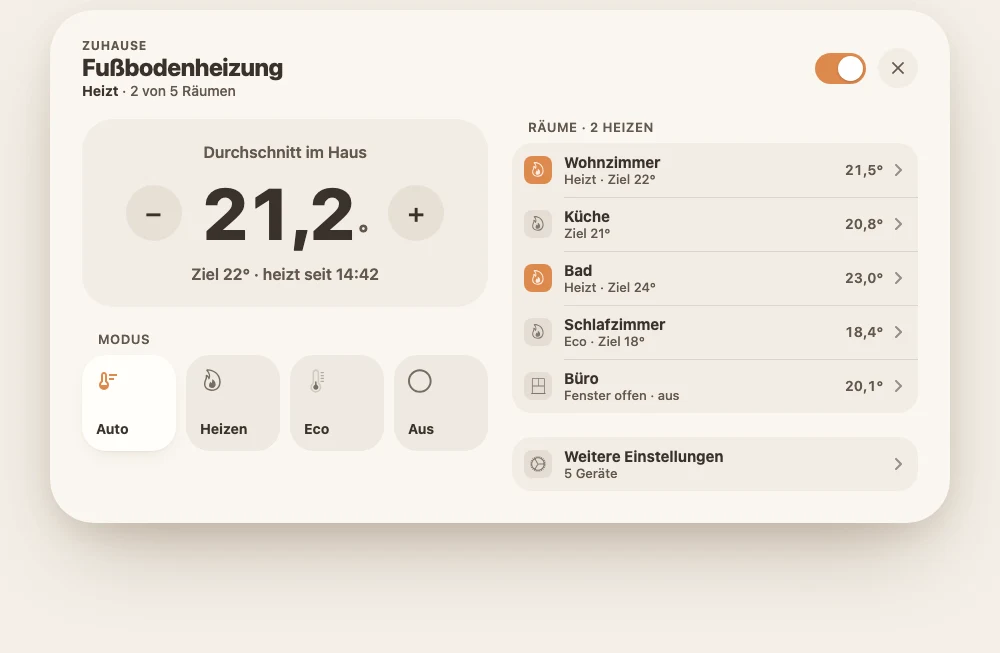
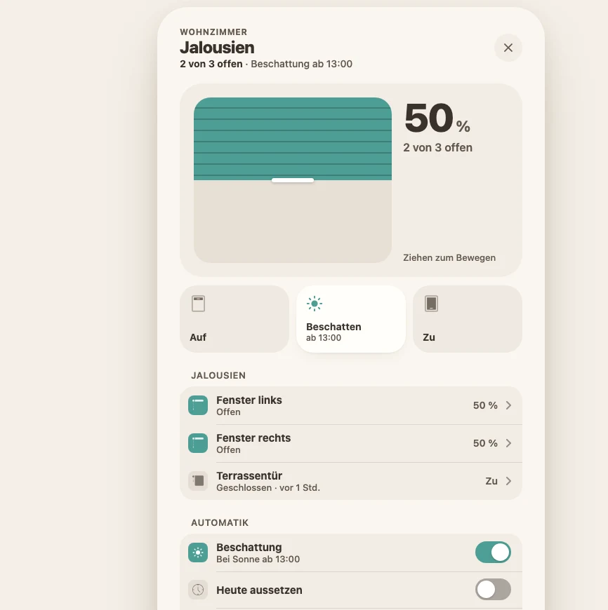
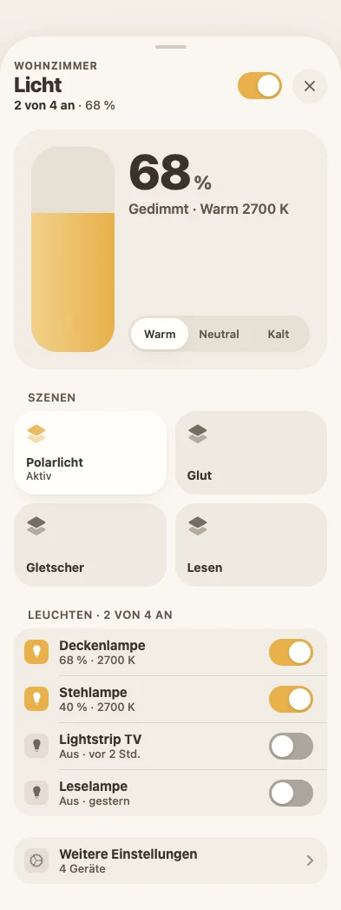
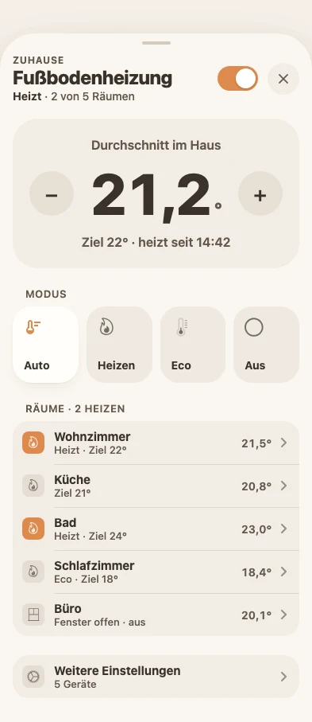
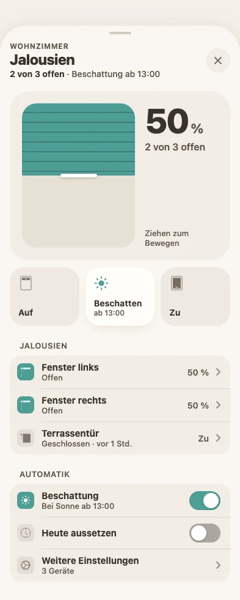

# Casora Popup-Richtlinien v3 „Bühne“

Gilt seit 28.10.2026 (Entscheidung Maintainer: „Richtung 1 für alle Popups“, Theme bleibt, Aufbau wird neu).
Diese Seite ist die Designsprache für **jedes** Casora-Popup – so wie Apples Human Interface Guidelines für iOS:
erst die Grundsätze, dann die Teile von oben nach unten, dann Maße, Zustände und Beispiele.

- **Theme bleibt**: Farben, Flächen, Schrift, Schatten und Radien kommen weiter aus „Casora“ (`theme_weich.yaml`) und
  [design-regeln.md](design-regeln.md). Neu ist nur der **Aufbau**.
- **Löst ab**: Kopf (Regel 1, Symbol-Kachel), Hauptbereich (Regel 3) und Aktionen (Regel 4) der
  [Blaupause v2](popup-blaupause.md). Was v2 sonst sagt (Zeilenarten, Unterseiten, „Weitere Einstellungen“, Mehr, Leer,
  Breite, Symmetrie, Zugang), gilt weiter – Übersicht in §15.
- **Arbeitsanweisung** für den Umbau aller Popups: [popup-rework-v3-auftrag.md](popup-rework-v3-auftrag.md).
- Nichts auf dieser Seite ist „OFFEN“. Passt ein Popup in keine Regel, gilt die **Rückfallregel** in §4.7.



---

## 1. Grundsätze

1. **Eine Sache zuerst.** Jedes Popup beantwortet oben in einem Blick die Frage, wegen der man es öffnet
   („Wie hell?“, „Wie warm?“, „Wie weit offen?“, „Ist alles zu?“). Das ist die **Bühne**.
2. **Gleiches steht an gleicher Stelle.** Kopf, Bühne, Schnellwahl, Listen, Einstellungen – in jedem Popup in dieser
   Reihenfolge. Wer ein Popup kennt, kennt alle.
3. **Direkt bedienen.** Ziehen, Tippen, ± – keine Menüs, keine versteckten Gesten für Häufiges.
4. **Ruhe vor Vollständigkeit.** Häufiges oben und groß, Seltenes unten in Listen, Seltenstes in „Mehr“.
5. **Zustand ohne Lesen.** Farbe, Form und Wort sagen dasselbe (Gerätefarbe = an/aktiv, grau = aus).
   Auswahl nie nur über Farbe.
6. **Nichts springt.** Das Popup erscheint erst, wenn alles sitzt; Werte ändern sich ohne Sprung der Fläche.

## 2. Anatomie

```
┌─────────────────────────────────────────────────────────────────┐
│ ETIKETT                                          [Schalter] (✕) │  Kopf        §3
│ Titel                                                           │
│ Zustand · Zusatz · Zusatz                                       │
├─────────────────────────────────────────────────────────────────┤
│ ┌───────────────────────────┐   LISTE                           │
│ │          Bühne            │   ┌─────────────────────────────┐ │  Bühne       §4
│ │  (genau eine, Typ S1–S8)  │   │ Zeile                     › │ │  Listen      §6
│ └───────────────────────────┘   │ Zeile                  [◯ ] │ │
│ SCHNELLWAHL                     └─────────────────────────────┘ │
│ ┌─────┐ ┌─────┐ ┌─────┐ ┌─────┐ EINSTELLUNGEN                   │  Schnellwahl §5
│ │     │ │     │ │     │ │     │ ┌─────────────────────────────┐ │
│ └─────┘ └─────┘ └─────┘ └─────┘ │ Weitere Einstellungen     › │ │  Einstell.   §8
│                                 └─────────────────────────────┘ │
│                                 Mehr (3) ⌄                      │  Mehr        §8
└─────────────────────────────────────────────────────────────────┘
```

| Fläche | Desktop ≥ 761 px | Handy |
|---|---|---|
| Mit Liste | 900 breit, **links** Bühne + Schnellwahl, **rechts** Listen + Einstellungen + Mehr | eine Spalte: Kopf → Bühne → Schnellwahl → Listen → Einstellungen → Mehr |
| Ohne Liste oder nur 1 Abschnitt | 552 breit, eine Spalte in derselben Reihenfolge | wie Desktop |
| Bild-Bühne (S5) | 900 breit, Bühne über **beide** Spalten, darunter links Schnellwahl, rechts Listen | eine Spalte |

Die Spalten beginnen auf derselben Höhe (v2 Regel 12, `UI.colsMark`). Am Handy ist das Popup ein Sheet von unten mit
Griff (vorhanden im Rahmen).

## 3. Kopf

```
ETIKETT                                           [Schalter]  (✕)
Titel
Zustand · Zusatz · Zusatz
```

| Teil | Regel | Maß |
|---|---|---|
| Symbol-Kachel | **entfällt** (die Bühne zeigt Farbe und Zustand) | – |
| Etikett | Raum; auf Unterseiten die Seite davor; bei Sammel-Popups leer | 12/700, Großbuchstaben, Sperrung .06em, Text 2 |
| Titel | Gerätename ohne Raum, höchstens 2 Zeilen, dann „…“ | 24/800, -0.02em (Handy 22) |
| Statuszeile | Zustand fett in Text 1, dann höchstens 2 Zusätze in Text 2, „·“ getrennt, eine Zeitform (unter 1 Std. „vor 11 Min.“, sonst „seit 14:42“) | 14/500, Zustand 14/700 |
| Hauptschalter | wie v2 Regel 2: schaltet, was die Kachel schaltet; nie bei Schloss, Alarm, Tor, Sirene | 51×31, Gerätefarbe |
| ✕ | immer, rechts außen | Kreis 40 auf Zeilenfläche, Trefferfläche 44 |
| ‹ | nur auf Unterseiten, links vor dem Etikett | Kreis 40 |
| Abstand Kopf → Bühne | | 20 |

Der Zustand steht nicht noch einmal groß auf der Bühne, **außer** als Wert (68 %, 21,2°) – die Bühne zeigt die
Zahl, die Statuszeile das Wort.

## 4. Bühne

Genau **eine** Bühne pro Popup, direkt unter dem Kopf, ohne Überschrift darüber. Sie ist eine Platte:
Fläche `--casora-soft-row-fill`, Radius **32** (`--casora-r-surface`), Innenabstand **20**, Abstand der Teile **16**.
Die Bühne nimmt vorhandene Bedienlogik (Live-Werte, Dienste, Rückfrage) und ordnet sie neu – keine zweite Logik
neben der alten.

### 4.1 Die Typen

| Typ | Name | Wofür | Aufbau |
|---|---|---|---|
| **S1** | Regler | Licht, Dimmer, Lautstärke als Hauptsache | links senkrechter Regler 96×236 (Handy 88×200), Radius 30, Füllung von unten in Gerätefarbe (`--casora-lps-fill`), Symbol unten im Regler; rechts groß der Wert, darunter ein Wort, unten ein Segment (z. B. Lichtfarbe) |
| **S2** | Wert mit ± | Thermostat, Fußbodenheizung, Klima, Befeuchter-Ziel, Velair | oben klein, was gezeigt wird („Durchschnitt im Haus“); Mitte − Wert + (Knöpfe 56 rund, Wert 72/800); unten Ziel und Zustand; Leiste darunter erlaubt (v2 Entscheidung 4) |
| **S3** | Position | Jalousie, Markise, Tor, Garage, Vorhang | links Grafik, die man zieht (Füllung von oben, Griff 60×6), rechts groß der Wert, darunter „2 von 3 offen“ |
| **S4** | Programm | Waschmaschine, Trockner, Spüler, 3D-Drucker, Saugroboter, Mäher, Kaffee | groß die Restzeit oder der Zustand („1:24 Std.“, „Bereit“), darunter Fortschrittsbalken 8 hoch, Programmname; die Hauptaktion („Jetzt starten · Eco 50°“) als Pille 52 hoch über die Bühnenbreite **in** der Bühne |
| **S5** | Bild | Kamera, Klingel, Frigate, Medien (Cover), Rezept | das Bild ist die Bühne (Kamera 16:9, Cover quadratisch), Bedienung (Wiedergabe, Sprechen) direkt darunter in derselben Platte |
| **S6** | Verlauf | Messwert, Energie, Batterie-Gerät, Pflanze, Diagramm-Kachel | groß der aktuelle Wert mit Einheit, daneben Trend („+0,4° in 1 Std.“), darunter Diagramm 160 hoch, Zeitraum-Umschalter als Segment |
| **S7** | Zustand | Sicherheit, Kontakte, Schloss, Alarm, Updates, Netzwerk, Person, Batterie-Übersicht, Wetterwarnung | Symbol 64 in Ampelfarbe, daneben ein Satz („Alles zu“, „2 Fenster offen“), darunter höchstens 3 Kennzahlen; eine Hauptaktion („Alle verriegeln“) als Pille in der Bühne, Gefährliches nie gefüllt |
| **S8** | Inhalt | Kalender, Abfall, Fußball, Szenen, Einkaufsliste, Liste von Entitäten, „Mehr“-Popup, Updates-Liste | keine eigene Bühne: der eigene Hauptbereich (Monatsraster, Tabelle, Szenenraster) steht an ihrer Stelle, in derselben Platte |

### 4.2 Wert-Schrift

| Wo | Maß |
|---|---|
| Wert S1/S3/S4/S6 | 56/800, -0.03em, Ziffern gleich breit (`tabular-nums`), Einheit 22/700 in Text 2 direkt dahinter |
| Wert S2 | 72/800 |
| Satz S7 | 22/800 |
| Wort/Zusatz unter dem Wert | 15/600, Text 2, 6 Abstand |

### 4.3 Bedienen auf der Bühne

- Ziehen und Tippen auf den Regler setzt den Wert (wie heute `.lps-bar` und `UI.slider`); Tastatur: Pfeile ±1 %,
  Bild auf/ab ±10 %; `role="slider"` mit `aria-valuenow`.
- Während des Ziehens zeigt der Wert live mit; der Dienst wird wie heute erst beim Loslassen gerufen.
- ± in S2: ein Tipp = ein Schritt des Geräts (`target_temp_step`, sonst 0,5°), Halten wiederholt.
- Die Bühne ist nie waagrecht scrollbar und nie höher als 280 (S5 ausgenommen).

### 4.4 Mehrere Geräte

Gruppen (Raum-Licht, Haus-Heizung, Jalousien eines Raums) zeigen auf der Bühne den **gemeinsamen** Wert (Mittel bzw.
Anteil) und bedienen alle; die einzelnen Geräte stehen rechts in der Liste.

### 4.5 Aus, offline, leer

- **Aus**: Bühne bleibt gleich groß, Füllung leer, Wert „Aus“ in Text 2, Bedienung bleibt nutzbar (Ziehen schaltet ein).
- **Nicht erreichbar**: Statuszeile sagt es, Bühne grau (Deckkraft .5), letzter Wert mit „zuletzt …“, keine Bedienung.
- **Noch kein Gerät**: Bühne enthält die Leer-Zeile (`UI.empty`) mit „Im Studio wählen ›“.

### 4.6 Zuordnung ohne Nachdenken

Für jedes Popup steht der Typ in der Tabelle des Auftrags
([popup-rework-v3-auftrag.md §5](popup-rework-v3-auftrag.md)). Neue Popups wählen nach dieser Reihenfolge:
1. Gibt es einen Wert, den man stufenlos stellt? → S1 (Helligkeit/Lautstärke) bzw. S3 (Position).
2. Stellt man einen Zielwert in Schritten? → S2.
3. Läuft ein Programm mit Ende? → S4.
4. Ist ein Bild das Wichtigste? → S5.
5. Zählt der Verlauf eines Messwerts? → S6.
6. Geht es um „ist alles in Ordnung?“ über mehrere Dinge? → S7.
7. Sonst → S8.

### 4.7 Rückfallregel

Passt ein Popup trotz Tabelle nicht (fehlende Daten, ungewöhnliches Gerät): **S7** mit dem Zustand der Kachel und
ohne Hauptaktion. Nie zwei Bühnen, nie eine leere Bühne.

## 5. Schnellwahl

Kacheln für die 2–4 häufigsten **Wahlen** – Modi, Szenen, Programme, Vorgaben („Auf / Beschatten / Zu“).

| Regel | Wert |
|---|---|
| Anzahl | 2 bis 4 in einer Reihe; Handy: 4 als 2 × 2, 3 bleiben eine Reihe |
| Kachel | gleich breit, mindestens 96 hoch, Radius 24, Innenabstand 14, Fläche `--casora-soft-control-fill` |
| Inhalt | Symbol 24 oben links, unten Titel 14/700, optional Unterzeile 12/500 („ab 13:00“, „Aktiv“) |
| Gewählt | Fläche `--casora-soft-row-active` mit `--casora-soft-row-active-shadow`, Symbol in Gerätefarbe, Unterzeile „Aktiv“ oder der Wert |
| Überschrift | nur wenn die Kacheln sich nicht selbst erklären („Szenen“, „Modus“); Stil der Listen-Überschrift §6 |
| Abstand | 16 unter der Bühne (mit Überschrift: 24 bis zur Überschrift), 10 zwischen den Kacheln |
| Mehr als 4 | die 3 häufigsten + Kachel „Alle (n)“ → Unterseite mit Auswahl-Liste (v2 Regel 6) |
| Verboten | Gefährliches (Entriegeln, Alarm aus, Sirene), An/Aus des Hauptschalters, Navigation › |

Antippen wählt sofort (kein „Übernehmen“); ist das Gerät aus, schaltet die Wahl es ein (v2 Regel 2).

## 6. Listen

Die Listen sind die gruppierten Platten aus Variante B (Commit „Popup rework variant B“, Tokens `--casora-pv-*`).

| Teil | Wert |
|---|---|
| Platte | eine pro Abschnitt, Fläche `--casora-popup-row-fill`, Radius 20, kein Abstand zwischen den Zeilen |
| Trennlinie | 1 px `--casora-pill-divider`, ab dem Text (52 vom Plattenrand), fehlt neben einer hinterlegten Zeile |
| Zeile | mindestens 52 hoch, Innenabstand 12 / 16 / 12 / 12, Symbol 28 mit Radius 8 (12 + 8 = 20 konzentrisch) |
| Symbol | aus: `--casora-soft-icon-off`; an/aktiv: Gerätefarbe mit weißer bzw. dunkler Glyphe (DP-17) |
| Titel / Unterzeile | 15/700 / 13/500 in Text 2, Unterzeile einzeilig mit „…“ am Handy |
| Rechts | Schalter (51×31) **oder** Wert 14/600 **oder** Wert + › **oder** ↗ – nie zwei Bedienteile |
| Überschrift | außen über der Platte, 13/600, Großbuchstaben, Sperrung .04em, Text 2, Einzug 16 (bündig mit dem Text), 8 bis zur Platte |
| Abstand | 24 zwischen Abschnitten und zwischen den Spalten |
| Reihenfolge | Bedienung → Zustand → Verlauf → Einstellungen (v2 Regel 5) |
| Lange Listen | ab 12 Zeilen die ersten 12 und „Alle (n) ›“ (v2 Regel 9) |

Die Überschrift darf zählen: „Leuchten · 2 von 4 an“, „Räume · 2 heizen“.

## 7. Diagramme

Grundlage ist Casoras eigene Diagrammkarte `custom:casora-chart` (`scripts/casora-chart.js`, Richtung A „ruhig“), in
Popups über `window._hpChartCfg(entity, titel, zeitraum, farbe, höhe)` (`01-basis.js`) und `HH.chart(titel, platte)`
(`02-devices.js`). Kein anderes Diagramm in Popups (keine apexcharts-Karte, kein eigenes SVG).

### 7.1 Wo ein Diagramm steht

| Rolle | Wann | Wo | Höhe |
|---|---|---|---|
| **Bühne** (S6) | Der Verlauf ist die Hauptsache: Messwert, Energie, Pflanze, Luftqualität, Diagramm-Kachel | in der Bühne, unter dem großen Wert | 160 (Handy 140) |
| **Abschnitt „Verlauf“** | Der Verlauf ergänzt eine andere Bühne: Temperatur bei Heizung/Thermostat, Leistung bei Waschmaschine, Trockner, Spüler, Drucker | rechte Spalte, Abschnitt „Verlauf“ nach „Zustand“ (Reihenfolge §6), eigene Platte | 120 |
| **In „Mehr“** | Fachwerte: Spannung, Stromstärke, Düse, Druckbett, zweite und dritte Messgröße | im Mehr-Block, je Messgröße eine Platte | 120 |

- **Höchstens ein Diagramm** außerhalb von „Mehr“ – entweder auf der Bühne (S6) oder als Abschnitt „Verlauf“, nie beides.
- **Nie** ein Diagramm über oder neben einer Bühne S1–S5; nie zwei Diagramme nebeneinander.
- **Mehrere Messgrößen** in einem Diagramm nur mit Legende und höchstens 4 Serien; sonst eine Serie und die Wahl über
  Auswahl-Zeilen in der Liste (v2 Entscheidung 3: Zeile tippen wechselt das Diagramm, gewählte Zeile hinterlegt, ohne ›).

### 7.2 Aussehen (Richtung A „ruhig“, gilt)

| Teil | Regel |
|---|---|
| Platte | Abschnitt/Mehr: Fläche `--casora-popup-row-fill`, Radius 20 wie die Listen; Bühne: in der Bühnen-Platte ohne eigene Fläche |
| Kopf der Platte | links Titel 15/700 („Temperatur“, „Leistung“), rechts „Details ›“ zur Messwertseite; auf der Bühne kein Titel (der Wert darüber sagt es) |
| Linie | 2 px, Fläche darunter 12 % → 0, Hilfslinien gepunktet, Skala rechts mit 3 Werten (wie `casora-chart` heute) |
| Balken | für Summen je Zeitraum (kWh je Tag, Verbrauch je Monat); Linie für Zustandsgrößen (Temperatur, Leistung, Feuchte) |
| Ablesen | keine schwebende Blase: auf der Bühne liest die große Zahl mit (`readout: 'hero'`), im Abschnitt die Zahl im Plattenkopf (`readout: 'own'`) |
| Zeitraum | Abschnitt/Mehr: fest 24 Std.; läuft ein Programm: 4 Std. Umschalter nur auf der Bühne (S6) und der Messwertseite, als Segment unter dem Diagramm: **24 Std. · 7 Tage · 30 Tage** (Diagramm-Kachel zusätzlich „Jahr“) – Wörter wie `27-chart.js` |
| Abstände | Kopf → Diagramm 8, Diagramm → Segment 16, Innenabstand der Platte 16 |

### 7.3 Farben

Nur Theme-Variablen, nie feste Farben im Aufruf (heute noch `#0A84FF`, `#8E8E93`, `#FF9F0A`, `#FF453A` – beim Umbau ersetzen):

| Messgröße | Farbe |
|---|---|
| eine Serie, die zum Gerät gehört (Leistung, Energie des Geräts, Helligkeit) | Gerätefarbe `--casora-popup-accent` |
| Temperatur | `--casora-color-orange` |
| Luftfeuchte, Wasser | `--casora-color-blue` |
| Luftqualität, CO₂ | `--casora-color-teal`; Grenzwerte als gepunktete Linie, Bereiche nie farbig füllen |
| Solar / Netz / Akku (Energie) | `--casora-color-yellow` / `--casora-color-neutral` / `--casora-color-green` |
| Spannung, Stromstärke, Nebenwerte | `--casora-color-neutral` |
| weitere Serien in einer Legende | `--casora-color-violet`, `--casora-color-pink`, `--casora-color-mint` in dieser Reihenfolge |

Linie gegen Platte mindestens 3 : 1, hell und dunkel (`popup-geo.mjs`). Ampelfarben (grün/orange/rot) nur für
Zustände, nie als Serienfarbe.

### 7.4 Zustände

- **Lädt**: Platte in Endhöhe, Fläche ruhig, keine Linie – das Popup springt nicht, wenn die Werte kommen
  (vorhandenes `data-casora-charts-ready`).
- **Keine Werte**: Leer-Zeile in derselben Höhe, „Noch keine Werte“ (DP-09) – keine leere Fläche, keine Achsen ohne Linie.
- **Nicht erreichbar**: letzte Werte grau, im Kopf „zuletzt 14:42“.
- **Fahrenheit, Einheiten, Dezimalstellen** wie die Wortliste und die Entität (`unit_of_measurement`, Anzeige-Genauigkeit).

### 7.5 Zugang

Jedes Diagramm hat einen Namen für die Sprachausgabe mit Zusammenfassung
(„Temperatur, letzte 24 Std., 19,8 bis 22,1 °C, jetzt 21,2 °C“); der Zeitraum-Umschalter ist ein Segment mit `role="tab"`.

## 8. Einstellungen und Mehr

- **Einstellungen** ist der letzte Abschnitt der rechten Spalte: Automatik-Schalter (z. B. „Beschattung“, „Heute
  aussetzen“) und als letzte Zeile „Weitere Einstellungen ›“ (`UI.settings`, v2 Regel 8).
- **Mehr** (`UI.more`) höchstens einmal, ganz unten, mit Anzahl und Unterzeile, was drin ist (v2 Regel 9).

## 9. Zustände des ganzen Popups

| Zustand | Verhalten |
|---|---|
| Lädt | Platten in Endgröße, Inhalt mit Fläche `--casora-soft-control-fill` statt Text; kein Spinner in der Mitte |
| Fehler beim Dienst | Wert springt auf den echten Zustand zurück, kurzer Hinweis in der Statuszeile (3 s) |
| Rückfrage | wie heute (`confirm`): der Knopf wird zu „Bestätigen“, kein eigener Dialog |
| Theme ohne Casora (Standard, Glas) | bleibt beim bisherigen Aufbau (v2); v3 gilt nur im Weich-Rahmen (`:host([soft])`) |

## 10. Bewegung

| Was | Wert |
|---|---|
| Popup öffnen | `--casora-ease-enter` / `--casora-dur-enter` (320 ms), nur `opacity` und `transform`, erst wenn alles sitzt |
| Wert auf der Bühne | Füllung 180 ms `cubic-bezier(.36,0,.16,1)`, beim Ziehen ohne Übergang |
| Schnellwahl wählen | Fläche 160 ms (`--casora-dur-feedback`), Druck `scale(var(--casora-press-scale))` |
| `prefers-reduced-motion` | alle Übergänge aus |

## 11. Handy (393, WebKit)

- Eine Spalte, Reihenfolge wie §2; Sheet-Rand 16, Kopf mit Griff.
- Bühne S1: Regler 88×200; S2: Wert 64; Schnellwahl 2 × 2 ab 4 Kacheln.
- Alles muss mit dem Daumen erreichbar sein: Bühne und Schnellwahl stehen im oberen Drittel des Sheets.
- **Immer in WebKit prüfen** (Safari/iPhone), nicht nur Chrome.

## 12. Zugang

- Trefferflächen mindestens 44 × 44 (Schnellwahl-Kachel und Zeilen ohnehin größer).
- Text auf Fläche mindestens 4,5 : 1, Symbole 3 : 1 – hell und dunkel (`dev/qa/popup-geo.mjs`).
- Regler, Schalter und ± mit Namen für die Sprachausgabe (`aria-label`, `role`, Wert).
- Auswahl zusätzlich über Form (Hinterlegung, Schatten), nie nur über Farbe.

## 13. Texte

- Wörter aus [wortliste.md](wortliste.md). Aktionen sagen, was passiert („Jetzt starten“, „Alle verriegeln“).
- Neue sichtbare Texte deutsch im Code, englisch in `translations/dashboard/phrases/en.json`, dann `tools/i18ncheck.py`.
- Keine Gerätekennungen in Titeln (`casoraCleanName`).

## 14. Bausteine und Tokens

| Baustein | Aufruf | Zweck |
|---|---|---|
| Rahmen-Schalter | `casora_popup.variant: 'v3'` in der Vorlage bzw. `variant: 'v3'` in `casoraPopup.open(cfg)` | Host-Attribut `data-casora-pv="v3"`: Kopf ohne Kachel, Tokens aus §3–§6; Unterseiten erben |
| Bühne | `UI.stage(type, o)` | Platte mit Typ S1–S8 (Felder in §5 des Auftrags) |
| Schnellwahl | `UI.quick(items, label?)` | `items: [{ icon, text, sub, active, svc, confirm }]` |
| Listen | `UI.section`, `UI.row.*`, `UI.group` | wie v2, Aussehen aus den `--casora-pv-*`-Tokens |
| Layout | `HH.layout({ …, stage: 'stage', quick: 'quick' })` und `_casoraSoftKit.layout` | Bühne + Schnellwahl links oben, Rest rechts |

| Token | Wert | Wofür |
|---|---|---|
| `--casora-v3-stage-radius` | 32 | Bühnen-Platte |
| `--casora-v3-stage-pad` | 20 | Innenabstand Bühne |
| `--casora-v3-stage-gap` | 16 | Teile in der Bühne |
| `--casora-v3-value-fs` / `-value-fs-big` | 56 / 72 | Wert S1/S3/S4/S6 / S2 |
| `--casora-v3-quick-h` / `-quick-radius` | 96 / 24 | Schnellwahl |
| `--casora-v3-head-title-fs` | 24 (Handy 22) | Titel im Kopf |
| `--casora-pv-*` | siehe `casora-core.js` (Variante B) | Listen, Segmente, Überschriften |

## 15. Verhältnis zur Blaupause v2

| v2 | in v3 |
|---|---|
| Regel 1 Kopf mit Symbol-Kachel | **ersetzt** durch §3 (ohne Kachel) |
| Regel 2 Hauptschalter | gilt |
| Regel 3 Hauptbereich | **ersetzt** durch §4 Bühne; Diagramme außerhalb der Bühne nach §7 |
| Regel 4 Aktionen-Reihe | **ersetzt**: Hauptaktion in der Bühne (S4/S7), Wahlen als Schnellwahl §5; `UI.actions` nur noch für Sammel-Popups ohne Bühnen-Aktion |
| Regel 5 Abschnittsfolge | gilt (§6) |
| Regel 6 Zeilenarten | gilt |
| Regel 7 Unterseiten | gilt (‹ im Kopf) |
| Regel 8 Weitere Einstellungen | gilt (§8) |
| Regel 9 Lange Listen, Mehr | gilt |
| Regel 10 Leer, aus, offline | gilt, ergänzt um §4.5 |
| Regel 11 Breite, Zugang | gilt (552/900), ergänzt um §2 |
| Regel 12 Symmetrie | gilt |
| Entscheidungen 1–6 (26.10.) | gelten; „ein Knopf-Stil“ (6) jetzt als Pille in der Bühne |

## 16. Richtig und falsch

| Richtig | Falsch |
|---|---|
| Eine Bühne mit dem Wert, den man am häufigsten ändert | Zwei große Bereiche übereinander (Diagramm **und** Regler) |
| Temperaturverlauf als Abschnitt „Verlauf“ rechts, 120 hoch | Temperaturverlauf über dem ±-Regler |
| Spannung und Stromstärke in „Mehr“ | Drei Diagramme untereinander in der rechten Spalte |
| Serienfarbe aus `--casora-color-*` bzw. Gerätefarbe | `#0A84FF`, `#8E8E93` im Aufruf |
| Szenen als 4 Schnellwahl-Kacheln | Szenen als Textlinks oder einzelne Fuß-Pillen |
| „Alle verriegeln“ gefüllt in der Bühne, „Alle entriegeln“ ungefüllt mit Rückfrage | Entriegeln als Schnellwahl-Kachel |
| Geräte als gruppierte Liste mit Schalter rechts | Jedes Gerät als eigene Platte mit 8 px Lücke |
| Überschrift „Leuchten · 2 von 4 an“ | Überschrift „Leuchten“ und darunter noch eine Zeile „2 von 4 an“ |
| Zustand als Wort in der Statuszeile, Wert groß auf der Bühne | Zustand dreimal (Statuszeile, Bühne, Liste) |
| Leere Bühne mit Leer-Zeile „Im Studio wählen ›“ | Popup ohne Bühne, weil ein Sensor fehlt |

## 17. Bilder (Mockups vom 28.10.2026)

| Licht (Raum) | Fußbodenheizung (Haus) | Jalousien (Raum) |
|---|---|---|
|  |  |  |
|  |  |  |

Die Mockups zeigen Aufbau und Maße; Symbole und Farben im echten Popup kommen aus dem Rahmen.
